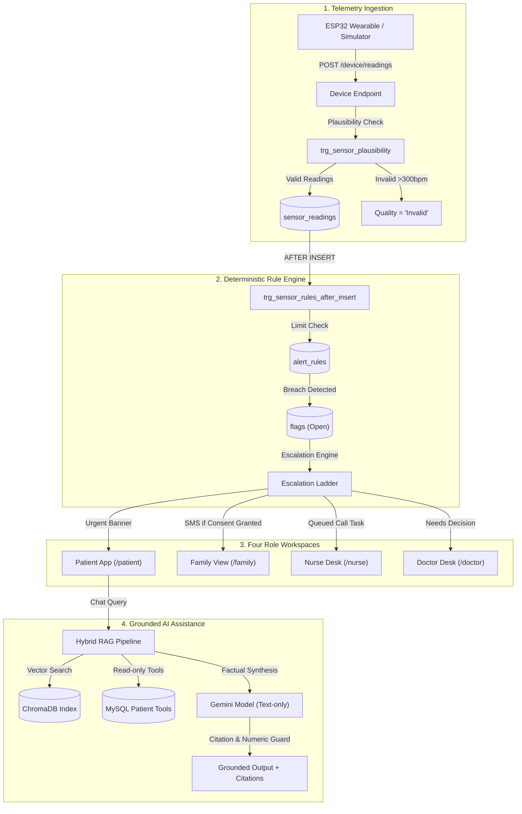
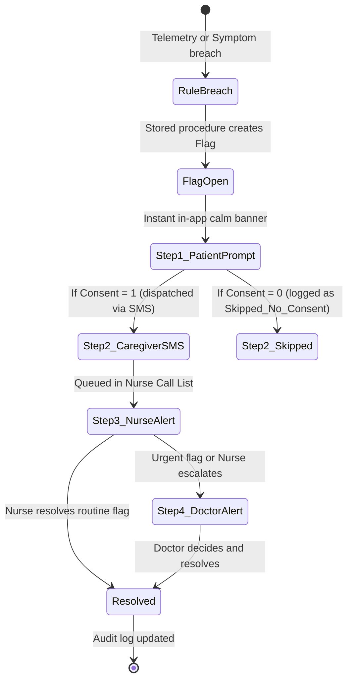

# CareLoop Technical & Clinical Architecture Guide

## Table of Contents
1. [Overview and Goals](#1-overview-and-goals)
2. [Architecture Diagram and Data Flow](#2-architecture-diagram-and-data-flow)
3. [Technology Stack](#3-technology-stack)
4. [Repository Folder Structure](#4-repository-folder-structure)
5. [Frontend Workstations & Design Tokens](#5-frontend-workstations--design-tokens)
6. [Backend Services, Endpoints & Escalation](#6-backend-services-endpoints--escalation)
7. [Database Schema, Views, Procedures & Triggers](#7-database-schema-views-procedures--triggers)
8. [AI Pipeline & Clinical Safeguards](#8-ai-pipeline--clinical-safeguards)
9. [Roles, Permissions & Escalation Chain](#9-roles-permissions--escalation-chain)
10. [Safety Principles & Honesty Boundaries](#10-safety-principles--honesty-boundaries)
11. [Synthetic Demo Cast & Walkthrough Script](#11-synthetic-demo-cast--walkthrough-script)
12. [Device Telemetry, ESP32 Firmware & Simulator](#12-device-telemetry-esp32-firmware--simulator)
13. [Testing Strategy & Kept Test Suites](#13-testing-strategy--kept-test-suites)
14. [Troubleshooting & Verification](#14-troubleshooting--verification)
15. [Limitations & Honest Future Scope](#15-limitations--honest-future-scope)

---

## 1. Overview and Goals

CareLoop is an engineering demonstration platform designed to support post-discharge recovery through remote telemetry, deterministic safety rules, and grounded assistant responses. The primary governing philosophy across all subsystems is:

> **"The LLM talks. Rules decide. Humans act."**

* **The LLM is text-only:** Generates draft summaries and answers patient questions strictly from discharge records. It never creates, alters, or resolves clinical flags, limits, or prescriptions.
* **Deterministic Rules Decide:** Clinical alerts, risk categorizations, and emergency detections are code-driven and rule-based. Emergency phrases (in English or Hindi) immediately trigger 112 guidance without invoking the LLM.
* **Humans Act:** Only qualified human clinicians review summaries, approve rule limits, triage calls, and resolve flags.

---

## 2. Architecture Diagram and Data Flow



---

## 3. Technology Stack

| Layer | Component | Version / Library | Purpose in CareLoop |
| :--- | :--- | :--- | :--- |
| **Frontend Framework** | React SPA | `18.2.0` (`react-scripts 5.0.1`) | Responsive web applications for all four roles |
| **Frontend Routing** | React Router | `7.11.0` | Client-side routing with role-based navigation guards |
| **Frontend UI & Tokens** | Tailwind CSS & Icons | `tailwindcss 3.4.17`, `lucide-react 0.562.0` | BhoomiSetu design token styling, dark/light theme |
| **Backend Framework** | FastAPI | `0.128.0` (Starlette TestClient) | REST API endpoints, JWT role enforcement, CORS |
| **ASGI Server** | Uvicorn | Standard | Asynchronous HTTP server |
| **Database** | MySQL | `8.0.16+` (InnoDB) | Relational store, stored procedures, triggers, views |
| **Database Driver** | PyMySQL | `1.1.1` (DictCursor) | Pure-Python transactional client with session time zone |
| **Vector Store** | ChromaDB | `0.5.23` | Embeddings and dense document chunk retrieval |
| **LLM Provider** | Google GenAI | `google-genai 0.1.1` | Gemini model access with strict offline fallbacks |
| **Auth & Security** | PyJWT & Bcrypt | `python-jose 3.5.0`, `bcrypt 5.0.0` | HS256 token encoding, secure demo password hashing |
| **IoT Wearable** | ESP32 Arduino C++ | Arduino Core | MAX30102 pulse oximeter & MPU6050 fall detector firmware |

---

## 4. Repository Folder Structure

```
CareLoop/
├── README.md                           # Quickstart guide, demo credentials, and disclaimer
├── PROJECT_GUIDE.md                    # Single authoritative clinical and technical guide
├── .gitignore                          # Excludes env, dependencies, caches, and local databases
├── .env.example                        # Template environment variables (no secrets)
├── backend/
│   ├── requirements.txt                # Python runtime dependencies
│   ├── app/
│   │   ├── __init__.py
│   │   ├── main.py                     # FastAPI application, route mounting, and middleware
│   │   ├── auth.py                     # JWT token issuance, verification, password hashing
│   │   ├── db.py                       # PyMySQL connection pool and session context manager
│   │   ├── models.py                   # Pydantic schemas for request/response payloads
│   │   ├── permissions.py              # Role dependencies (require_doctor, require_nurse, etc.)
│   │   ├── clinical_summaries.py       # SBAR fact-sheet builder, AI drafting, and safety guard
│   │   ├── escalation.py               # Escalation ladder state machine and SMS dispatch simulator
│   │   ├── governance_interop.py       # HL7 FHIR R4 JSON export and LACE risk calculation
│   │   ├── llm.py                      # Single resilient Gemini API wrapper
│   │   ├── rag.py                      # Core RAG functions, emergency terms, dose refusals
│   │   ├── rag_config.py               # Assistant prompts, refusal templates, intent taxonomy
│   │   ├── rag_pipeline.py             # Advanced RAG: hybrid search, numeric/citation guards
│   │   ├── rag_tools.py                # Read-only SQL tools for discharge assistant
│   │   ├── safety.py                   # Plain-code emergency detection and dose check logic
│   │   └── scheduler.py                # Periodic task runner for SLA evaluation and timeouts
│   └── rag_eval/
│       ├── golden.jsonl                # 44 golden benchmark queries for RAG grounding
│       └── run_eval.py                 # Grounding accuracy evaluation runner
├── database/
│   ├── schema.sql                      # Unified MySQL DDL (tables, views, procedures, triggers)
│   └── reset_demo.sql                  # Idempotent demo dataset reset SQL script
├── device/
│   ├── simulator.py                    # Sensor simulator streaming Heart Rate and SpO2
│   ├── watch_bridge.py                 # Bluetooth serial forwarder to /device/readings
│   └── esp32_careloop/
│       └── esp32_careloop.ino          # ESP32 MAX30102/MPU6050 hardware firmware
├── frontend/
│   ├── package.json                    # Node dependencies and build scripts
│   ├── tailwind.config.js              # Tailwind styling definitions
│   ├── public/
│   │   ├── index.html                  # HTML entry point with web fonts
│   │   └── careloop_logo.jpg           # CareLoop branding logo
│   └── src/
│       ├── index.js                    # React root renderer
│       ├── index.css                   # Global CSS variables, BhoomiSetu tokens, reset rules
│       ├── App.js                      # React router configuration and RoleRouteGuard
│       ├── ThemeContext.js             # Dark and light theme state provider
│       ├── components/                 # Role workspaces and clinical components
│       │   ├── AuditLogViewer.jsx      # Doctor-only audit log inspection drawer
│       │   ├── CareLoopLogin.jsx       # Glassmorphism login portal with 1-click role buttons
│       │   ├── CareLoopPatientPortal.jsx # Patient recovery home, check-in, and assistant
│       │   ├── CareLoopStaffPortal.jsx # Staff workstation shell housing Doctor and Nurse views
│       │   ├── ClinicalSummaries.jsx   # Clinical SBAR summary review, edit, and sign-off
│       │   ├── DoctorFhirExportView.jsx # Doctor FHIR R4 JSON bundle export view
│       │   ├── DoctorLimitsView.jsx    # Doctor limit approvals and pathway rules
│       │   ├── FamilyPortal.jsx        # Consent-gated family helper schedule
│       │   ├── FlagDrawer.jsx          # Clinical flag detail drawer with escalation history
│       │   ├── Icons.jsx               # SVG icon primitives
│       │   ├── Landingpage.jsx         # Public landing page with 4 role cards and real counts
│       │   ├── NurseCallListView.jsx   # Nurse priority triage call queue
│       │   ├── NurseCallModal.jsx      # Nurse call logging modal with quick outcome notes
│       │   ├── NurseProposeLimitModal.jsx # Nurse threshold proposal modal
│       │   ├── NurseTaskCompleteModal.jsx # Nurse task completion dialog
│       │   ├── OperationalInsights.jsx # Clinical operations and response SLA metrics
│       │   ├── PatientDirectory.jsx    # Complete patient directory with ABHA IDs
│       │   ├── PatientIdentity.jsx     # Reusable patient demographic and ID badge
│       │   ├── PatientOverviewTab.jsx  # Comprehensive clinical chart and recovery timeline
│       │   ├── ShiftHandoff.jsx        # I-PASS structured shift handoff tool
│       │   ├── SwitchDemoWorkspace.jsx # Top-bar demo workspace switcher and reset button
│       │   ├── TaskQueue.jsx           # Multi-staff follow-up task management queue
│       │   └── ThemeToggle.jsx         # Dark/light theme switcher toggle
│       └── services/
│           └── api.js                  # Axios/fetch HTTP client with JWT interceptors
├── scripts/
│   ├── reset_demo.py                   # Sub-second reset command runner
│   ├── seed_demo.py                    # Synthetic data seeder
│   ├── validate_demo.py                # 12-check validation suite
│   ├── simulate_event.py               # Live SpO2 91% event simulator
│   ├── index_document.py               # Discharge PDF/text chunker and Chroma indexer
│   └── set_demo_passwords.py           # Demo account password hash utility
└── tests/
    ├── test_role_permissions_p2.py     # Role isolation, data privacy, and HTTP 403 checks
    ├── test_doctor_desk_p3.py          # Doctor decision desk, approvals, and FHIR export
    ├── test_nurse_desk_p4.py           # Nurse call list, task workflows, and limit proposals
    ├── test_patient_family_p5.py       # Patient daily regimen, check-ins, and family consent
    ├── test_connected_demo_p6.py       # End-to-end connected demo event and reset validation
    └── test_phase7_acceptance.py       # LLM-offline resilience and Section 10 contract checks
```

---

## 5. Frontend Workstations & Design Tokens

### Role Color Accents (BhoomiSetu Standard)
* **Doctor (`/doctor`):** Navy / Slate (`#0284c7`, CSS `--accent-doc`) — Symbolizes governance, clinical authority, and medical oversight.
* **Nurse (`/nurse`):** Amber / Orange (`#d97706`, CSS `--accent-nurse`) — Symbolizes active execution, triage urgency, and care coordination.
* **Patient (`/patient`):** Emerald / Teal (`#059669`, CSS `--accent-patient`) — Symbolizes personal recovery, calm assurance, and daily actions.
* **Family Helper (`/family`):** Violet / Purple (`#7c3aed`, CSS `--accent-family`) — Symbolizes supportive care, loved-one context, and consent-bound assistance.

### Typography and Themes
* **Fonts:** `Inter` (body copy, numbers, data tables) and `Outfit` (headings, badges, primary numbers).
* **Theme Switching:** Managed via `ThemeContext.js` through `data-theme="dark"` or `"light"`. CSS custom variables adapt backgrounds (`--bg-base`, `--bg-surface`), borders (`--border-subtle`), and text (`--text-primary`, `--text-secondary`).

### Accessibility Standards
* **WCAG 2.1 AA Compliant:** Minimum 44px tap targets on interactive buttons, visible `:focus-visible` rings, `aria-live` announcements for alert banners, and high-contrast color pairings.
* **Bilingual UI:** Patient portal supports instant language toggling between English (`en`) and Hindi (`hi`).

---

## 6. Backend Services, Endpoints & Escalation

### Permission Matrix & Security
* **Doctor Only:** `/staff/doctor/decisions`, `/staff/audit-log`, `/staff/patients/{pid}/fhir`, `/staff/summaries/{id}/approve`, `/staff/summaries/{id}/reject`, `/staff/rules/{id}/approve`.
* **Staff (Doctor or Nurse):** `/staff/patients`, `/staff/patients/{pid}`, `/staff/flags`, `/staff/tasks`, `/staff/handoff`, `/staff/notes`.
* **Nurse Only Workflow:** `/staff/nurse/call-list`, `/staff/nurse/contact-log`, `/staff/nurse/propose-limit`.
* **Patient Only:** `/patient/me/today`, `/patient/me/doses`, `/patient/me/doses/{id}/taken`, `/patient/me/doses/{id}/undo`, `/patient/me/checkin`, `/patient/me/chat`, `/patient/me/consent/caregiver`.
* **Family Helper Only:** `/family/me/today`, `/family/me/dose/{id}/helped`. Forbidden from clinical chat, clinician notes, and symptom free-text.

### Escalation State Machine


---

## 7. Database Schema, Views, Procedures & Triggers

### Relational Entities (32 Tables)
1. **Core Identity:** `patients`, `care_staff`, `caregivers`, `user_accounts`, `care_assignments`.
2. **Clinical Records:** `discharge_records`, `discharge_documents`, `document_chunks`, `prescriptions`, `prescription_times`, `medicines`.
3. **Telemetry & Sensoring:** `devices`, `sensor_readings`.
4. **Safety & Rules:** `alert_rules`, `alert_rules_history`, `flags`, `flag_events`, `escalations`.
5. **Execution & Tasks:** `medication_logs`, `symptom_reports`, `symptom_report_tags`, `follow_up_tasks`, `contact_log`, `clinician_notes`, `appointments`.
6. **AI & Audit:** `ai_summaries`, `chat_messages`, `chat_message_sources`, `chat_feedback`, `risk_context`, `risk_snapshots`, `audit_log`.

### Views (8)
* `v_device_status`: Real-time connectivity and last-seen telemetry times.
* `v_latest_risk`: Cached composite clinical risk score per patient.
* `v_latest_sensor_readings`: Latest valid physiological readings per metric.
* `v_medication_adherence`: 7-day adherence percentages across confirmed doses.
* `v_patient_timeline`: Merged chronological stream of vitals, doses, notes, and alerts.
* `v_pending_followups`: Unresolved staff follow-up tasks with priority.
* `v_triage_board`: Open clinical flags sorted by severity and elapsed time.
* `v_worklist_by_patient`: Patient-aggregated worklist with SLA rankings.

### Stored Procedures (16)
* `sp_generate_daily_doses(target_date)`: Creates daily dose schedule rows from active prescriptions.
* `sp_mark_overdue_doses_missed()`: Marks unconfirmed doses past due window as Missed.
* `sp_acknowledge_flag(flag_id, staff_id)`: Atomically transitions flag to Acknowledged.
* `sp_resolve_flag(flag_id, staff_id, resolution_code, note)`: Atomically closes flag with mandatory clinical reason.
* `sp_assign_flag(flag_id, staff_id)`: Reassigns flag ownership.
* `sp_claim_task(task_id, staff_id)` / `sp_assign_task(...)` / `sp_snooze_task(...)`: Follow-up task operations.
* `sp_complete_task(task_id, staff_id, outcome_code, note)`: Completes task with structured clinical outcome.
* `sp_approve_summary(summary_id, staff_id, text)` / `sp_reject_summary(...)`: Doctor summary review lifecycle.
* `sp_daily_report(patient_id, report_date)`: Generates deterministic fact-sheet metrics.
* `sp_compute_risk_snapshot(patient_id)` / `sp_compute_all_risk_snapshots()`: Calculates LACE-influenced risk index.
* `sp_evaluate_missed_dose_rules()`: Checks for consecutive missed dose breaches.
* `sp_evaluate_no_data_rules()`: Detects missing telemetry transmissions exceeding rule thresholds.

### Triggers (3)
* `trg_sensor_plausibility`: (BEFORE INSERT on `sensor_readings`) Marks values outside physiological bounds (e.g., HR > 300 bpm or SpO2 > 100%) as `Invalid`.
* `trg_sensor_rules_after_insert`: (AFTER INSERT on `sensor_readings`) Evaluates active rules on valid readings and creates `flags` on breach.
* `trg_symptom_rules_after_insert`: (AFTER INSERT on `symptom_reports`) Raises flags for severe pain ($\ge 7$) or emergency terms, with 60-minute duplicate suppression.

---

## 8. AI Pipeline & Clinical Safeguards

### Grounded RAG Assistant Architecture
```
Patient Question
       │
       ▼
1. Emergency Keyword Filter (Plain code, EN & HI) ──[Matches]──► Immediate 112 guidance
       │ (No match)
       ▼
2. Dose Change Refusal Guard (Plain code) ─────────[Matches]──► Refusal + Care Team Alert
       │ (No match)
       ▼
3. Intent Router ──[Structured Intent]──► Direct Read-Only SQL Tool (Appointment/Meds/Vitals)
       │ (General Document Query)
       ▼
4. Hybrid Retrieval (Chroma Dense Vector + MySQL Keyword Search + Reciprocal Rank Fusion)
       │
       ▼
5. Strict Prompt Constraint: "Answer ONLY from CONTEXT. If missing, say NOT_IN_DOCUMENTS."
       │
       ▼
6. Numeric & Citation Guard: Verifies all numbers match source records. Rejects hallucinations.
```

### Deterministic SBAR Clinical Summaries
1. **Deterministic Fact Sheet:** Aggregates objective counts (readings, missed doses, reported symptoms, open flags) into structured JSON.
2. **Draft Generation:** Gemini model formats facts into SBAR format (Situation, Background, Assessment, Recommendation).
3. **Adjective Guard:** Rejects summaries containing banned judgment words: *"stable"*, *"normal"*, *"optimal"*, *"improving"*, *"worsening"*.
4. **Offline Fallback:** If the LLM is offline or raises an exception, the system outputs the deterministic fact sheet as a draft SBAR note without failing.

---

## 9. Roles, Permissions & Escalation Chain

| Feature / Action | Doctor (Dr. Ananya Sharma) | Nurse (Priya Nair) | Patient (Aarav Patel) | Family Helper (Neha Patel) |
| :--- | :---: | :---: | :---: | :---: |
| **Landing Workspace** | `/staff/doctor/decisions` | `/staff/nurse/call-list` | `/patient` | `/family` |
| **Primary Responsibility** | Clinical governance & decisions | Care coordination & calls | Self-care regimen & check-in | Consent-gated daily support |
| **Acknowledge / Call Patient** | Yes | Yes | N/A | N/A |
| **Resolve Routine Flags** | Yes | Yes | N/A | N/A |
| **Resolve Urgent / Emergency Flags**| **Yes** | No (Escalates to Doctor) | N/A | N/A |
| **Approve / Reject AI Summaries** | **Yes** | No (HTTP 403) | N/A | N/A |
| **Approve Telemetry Limits** | **Yes** | No (Can Propose only) | N/A | N/A |
| **Audit Log Inspection** | **Yes** | No (HTTP 403) | N/A | N/A |
| **HL7 FHIR R4 Bundle Export** | **Yes** | No (HTTP 403) | N/A | N/A |
| **Mark Dose Taken / Undo** | No | No | **Yes (1-Tap & 5-min Undo)** | Yes (I helped Aarav) |
| **Submit Symptom Check-in** | No | No | **Yes (Slider & Chips)** | No |
| **Discharge Q&A Assistant** | No | No | **Yes (Grounded)** | No (HTTP 403) |
| **Toggle Family Consent** | No | No | **Yes (Live switch)** | No |
| **See Clinical Notes / Free-Text** | Yes | Yes | Yes | **No (Zero leakage)** |

---

## 10. Safety Principles & Honesty Boundaries

1. **No Medical Thresholds in Code:** Alert limits come only from doctor-approved records in `alert_rules`.
2. **Valid Readings as Headline:** The headline reading in the patient and staff portals is always the latest `Valid` reading. Spurious telemetry (e.g. 450 bpm) is tagged `Invalid` and surfaced as a clean data check note (`"1 reading ignored: impossible value"`).
3. **Emergency Bypass:** Detection of life-threatening symptoms never waits for LLM responses. Plain regex pattern matching routes patients directly to emergency guidance.
4. **Immediate Consent Cutoff:** When a patient toggles family sharing off, caregiver access is revoked immediately across all queries.
5. **No Unprovable Claims:** Interface and documentation completely prohibit unprovable marketing claims (*"prevents readmissions"*, *"100% accurate"*, *"hardware-verified"*, *"AI detected"*).

---

## 11. Synthetic Demo Cast & Walkthrough Script

### The 5 Synthetic Demo Patients

| Patient | Diagnosis | Day Post-Discharge | Baseline Scenario & Flag State |
| :--- | :--- | :--- | :--- |
| **Aarav Patel** | Post-CABG recovery | **Day 3** | Baseline candidate: valid headline vitals (74 bpm, 98% SpO₂), invalid 450 bpm spike ignored, family sharing active. Target of live SpO₂ event simulation. |
| **Meera Joshi** | Heart Failure | **Day 6** | Open `Review_Soon` flag: silent telemetry device (>24h without data). Family consent revoked by patient. |
| **Rajesh Kumar** | Acute MI | **Day 5** | Open `Urgent_Review` flag: acute emergency symptom check-in (chest pressure) with nurse call task. |
| **Kabir Mehta** | Valve Replacement | **Day 9** | Historical candidate: resolved flag with full audit history, approved summary ready. |
| **Sunita Rao** | Post-PCI Stenting | **Day 4** | Open `Review_Soon` flag: two consecutive missed medication doses with pending nurse call task. |

### The 6:30 Minute Connected Demo Walkthrough

| Time | Persona | Action & Demonstration Steps | Key Message to Audience |
| :--- | :--- | :--- | :--- |
| **0:00** | **Landing Page** | Point to the 4 role cards with their Section 2.1 pitches and distinct accent colors. | CareLoop is built around 4 distinct roles with separated scopes. |
| **0:30** | **Patient (Aarav)** | Home shows next medicine $\rightarrow$ tap **Taken** $\rightarrow$ opens Check-in (pain 2) $\rightarrow$ asks *"When is my next appointment?"* (answers with cited source chip) $\rightarrow$ asks *"Can I double my dose?"* (safe refusal). | Patient acts; assistant is strictly grounded and refuses dose changes. |
| **2:00** | **Presenter** | Click **"Send test reading"** (SpO₂ 91% for Aarav). | Wearable telemetry streams into the clinical rules engine. |
| **2:15** | **Patient** | Banner updates: *"Your care team has been told. Call 112 if you have chest pain."* | Patient receives immediate, calm, actionable guidance. |
| **2:30** | **Family (Neha)** | Refresh family view: sees action item *"The care team is checking on Aarav. Please contact him."* Taps **"I helped Aarav take it"** on evening dose. | Family helper is informed without seeing private medical notes. |
| **3:15** | **Nurse (Priya)** | My Call List shows Aarav at top with timer and reason (*"SpO₂ reading 91% is below approved limit of 94%"*). Clicks **Call**, logs note, clicks **Ask Doctor**. | Nurse works the queue and escalates explainable flags. |
| **4:15** | **Doctor (Dr. Sharma)**| Needs My Decision shows Aarav with nurse's note and Rajesh's emergency item. Opens flag drawer $\rightarrow$ checks limit provenance $\rightarrow$ **Resolve**. Opens Approvals $\rightarrow$ reviews SBAR summary $\rightarrow$ **Approves**. | Doctor governs and decides; AI drafts, humans sign. |
| **5:30** | **Doctor $\rightarrow$ Audit** | Opens Audit Log: inspects end-to-end chain (reading, flag, SMS, call log, escalation, resolution, summary sign-off). | Every action is permanently audited. |
| **6:00** | **Patient Home** | Toggles **Family sharing: Off**. Switch to family view: displays *"Aarav has turned sharing off."* | Patient privacy and consent are absolute. |
| **6:30** | **Conclusion** | Recite core governing principle: *"The LLM talks. Rules decide. Humans act."* | Reliable post-discharge engineering. |

---

## 12. Device Telemetry, ESP32 Firmware & Simulator

### Hardware Specifications
* **Microcontroller:** ESP32 DevKit V1 (30-pin / 36-pin).
* **Sensors:**
  - MAX30102 via $I^2C$ (SDA: GPIO 21, SCL: GPIO 22) measuring optical PPG for Heart Rate (bpm) and SpO₂ (%).
  - MPU6050 Accelerometer/Gyroscope for fall detection ($\sqrt{x^2+y^2+z^2} > 2.8g$).
* **Local Display:** SSD1306 0.96" OLED ($I^2C$ address `0x3C`).

### Software Telemetry Simulator
The Python simulator (`device/simulator.py`) generates physiological telemetry without requiring physical hardware:
```bash
# Continuous streaming every 10 seconds
python3 device/simulator.py --interval 10

# Single low SpO2 breach cycle (89-91%) for alert testing
python3 device/simulator.py --low-spo2 --once
```

---

## 13. Testing Strategy & Kept Test Suites

### The 6 Core Test Suites (51 Passing Tests)

```bash
PYTHONPATH=. ./backend/env/bin/pytest \
  tests/test_role_permissions_p2.py \
  tests/test_doctor_desk_p3.py \
  tests/test_nurse_desk_p4.py \
  tests/test_patient_family_p5.py \
  tests/test_connected_demo_p6.py \
  tests/test_phase7_acceptance.py -v
```

1. **`test_role_permissions_p2.py` (14 tests):** Enforces role boundary HTTP 403s, IDOR token binding, family consent toggle cutoff, and nurse vs doctor flag authority.
2. **`test_doctor_desk_p3.py` (7 tests):** Tests doctor decision queue, AI summary approval/rejection, limit proposals, and HL7 FHIR R4 JSON export.
3. **`test_nurse_desk_p4.py` (7 tests):** Tests nurse call list queue, contact call logging, task completion with outcome codes, and shift handoffs.
4. **`test_patient_family_p5.py` (9 tests):** Tests daily regimen, 5-minute undo, check-in emergency detection, grounded RAG citations, and family zero-leakage view.
5. **`test_connected_demo_p6.py` (5 tests):** Tests sub-second database reset, live SpO₂ drop event simulation, and landing page claims.
6. **`test_phase7_acceptance.py` (9 tests):** Tests offline LLM resilience (deterministic tool fallbacks, extractive chunk grounding, SBAR draft fallback), English/Hindi 112 emergency bypass, and headline vital filtering (ignoring 450 bpm).

---

## 14. Troubleshooting & Verification

| Problem | Root Cause | Solution |
| :--- | :--- | :--- |
| Database connection error (`1045 Access Denied`) | Credentials mismatch in `.env` | Ensure `.env` has `DB_USER=careloop_api` and `DB_PASSWORD=careloop_dev_pass`. |
| Flag count mismatch after testing | Transactional tests modified flags | Run `python3 scripts/reset_demo.py` (< 0.25s) to restore baseline. |
| AI Assistant returns fallback | LLM API key missing or unreachable | Verify `GOOGLE_API_KEY` in `.env`. If offline, assistant operates in deterministic fallback mode. |
| Port 8000 or 3000 already in use | Stale background process | Kill process: `lsof -ti:8000 \| xargs kill -9`. |

---

## 15. Limitations & Honest Future Scope

* **Synthetic Data Prototype:** All records, patient names, and thresholds are synthetic test values. CareLoop is not certified as a medical device.
* **Single Selected Region:** Configured for single-region deployment without multi-region cross-replication.
* **No Closed-Loop Prescribing:** System never adjusts medicine dosages or modifies clinical regimens autonomously.
* **Future Work:** Hospital EHR bi-directional integration via FHIR subscription hooks, clinical trials for alarm fatigue mitigation, and automated hardware device onboarding.

