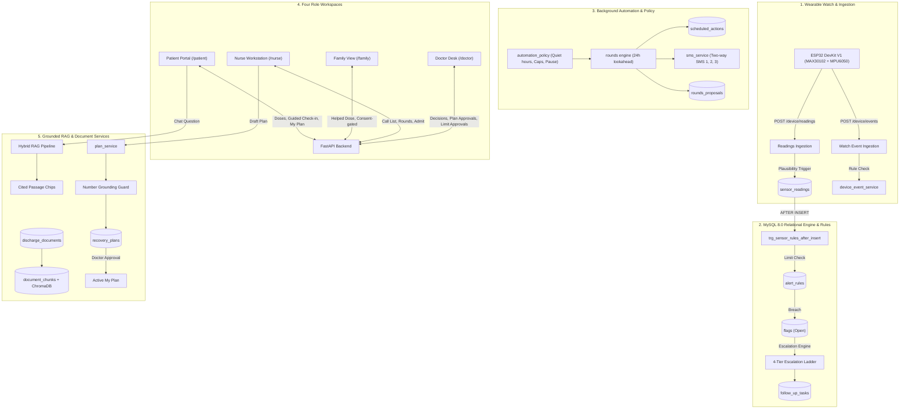
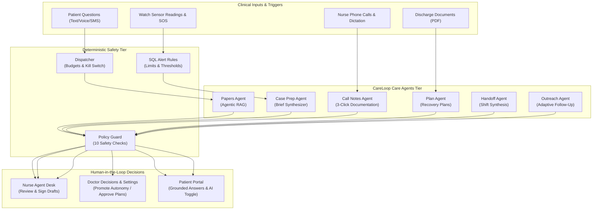
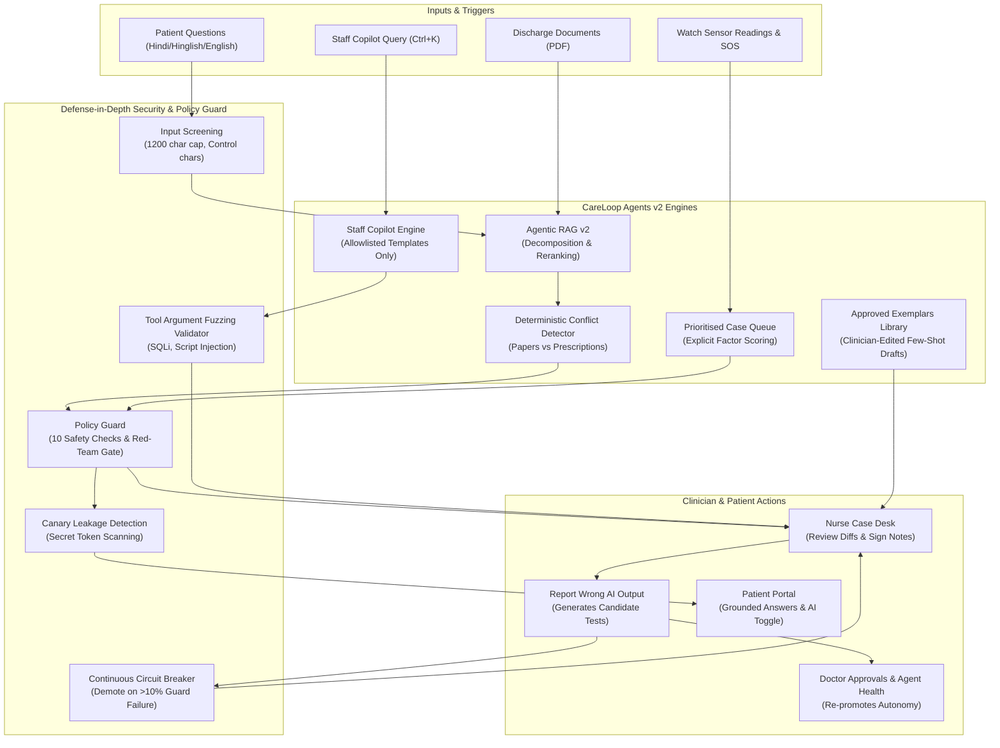

# CareLoop Technical & Clinical Architecture Guide

> [!IMPORTANT]
> **Synthetic-data prototype, not a medical device.**  
> CareLoop is an engineering demonstration platform designed to evaluate post-discharge remote patient monitoring and clinical agent workflows. All patient records, clinical notes, sensor readings, and limits are synthetic test data. It is not approved for clinical diagnostic use, does not provide medical diagnoses, and never substitutes for professional clinical judgment.

---

## 🏛️ Governing Headline & Principle

> # **"Agents do the routine. People make the calls."**  
> *"CareLoop keeps the days after discharge from going quiet: agents prepare every case and answer from the patient's own papers, rules raise every alert with its reason, and people make every decision."*

* **The Core Rule:** *"The LLM talks. Rules decide. Humans act."*
* **Every case arrives prepared:** Clinical alarms are pre-compiled into concise briefs with grounded facts, pre-identified unknowns, and fixed administrative next steps.
* **Autonomy is earned:** Every automated action starts in Shadow Mode until agreement is proven from data; promotion to Live is strictly doctor-governed.
* **Pause with one switch:** An emergency kill switch halts all automated agents immediately without affecting rules, reminders, or escalation.
* **Patients retain control:** Patients can turn off automated assistance at any time from their home screen.

---

## Table of Contents
1. [Overview, Positioning & Scope Boundaries](#1-overview-positioning--scope-boundaries)
2. [What CareLoop Adds: Comparison Table](#2-what-careloop-adds-comparison-table)
3. [Architecture Diagram and End-to-End Data Flow](#3-architecture-diagram-and-end-to-end-data-flow)
4. [Technology Stack](#4-technology-stack)
5. [Repository Folder Structure](#5-repository-folder-structure)
6. [Core Clinical Services & Workflows](#6-core-clinical-services--workflows)
   - [6.1 Rounds & Automation Policy](#61-rounds--automation-policy)
   - [6.2 Two-Way SMS & Guided Check-in](#62-two-way-sms--guided-check-in)
   - [6.3 Recovery Plan Drafter & Admission](#63-recovery-plan-drafter--admission)
   - [6.4 Watch Events & Possible Fall Service](#64-watch-events--possible-fall-service)
7. [CareLoop Care Agents Tier](#7-careloop-care-agents-tier)
   - [7.1 Papers Agent (Agentic RAG)](#71-papers-agent-agentic-rag)
   - [7.2 Case Prep Agent (Brief Synthesizer)](#72-case-prep-agent-brief-synthesizer)
   - [7.3 Call Notes Agent (3-Click Documentation)](#73-call-notes-agent-3-click-documentation)
   - [7.4 Outreach Agent (Adaptive Follow-Up)](#74-outreach-agent-adaptive-follow-up)
   - [7.5 Handoff Agent (Shift Synthesis)](#75-handoff-agent-shift-synthesis)
   - [7.6 Plan Agent (Recovery Plans)](#76-plan-agent-recovery-plans)
   - [7.7 Deterministic Policy Guard (10 Checks)](#77-deterministic-policy-guard-10-checks)
8. [Workload Replay Benchmark & Empirical Metrics](#8-workload-replay-benchmark--empirical-metrics)
9. [Database Schema, Views, Procedures & Triggers](#9-database-schema-views-procedures--triggers)
10. [Roles, Permissions & Security Matrix](#10-roles-permissions--security-matrix)
11. [Safety Principles & Honesty Boundaries](#11-safety-principles--honesty-boundaries)
12. [Synthetic Demo Cohort & 8-Minute Demo Story](#12-synthetic-demo-cohort--8-minute-demo-story)
13. [Hardware Specifications & IoT Simulator](#13-hardware-specifications--iot-simulator)
14. [Testing Strategy & Test Suites (46 Care Agent Tests)](#14-testing-strategy--test-suites-46-care-agent-tests)
15. [Regulatory and Ethics Analysis (ICMR 2023 & CDSCO MDSW)](#15-regulatory-and-ethics-analysis-icmr-2023--cdsco-mdsw)
16. [Troubleshooting & Verification](#16-troubleshooting--verification)

---

## 1. Overview, Positioning & Scope Boundaries

CareLoop is a post-discharge patient care and clinical agents platform designed to keep the critical recovery days after hospital discharge from going quiet.

### Scope Separation: Core Scope vs Extensions

Per committed project requirements:

* **Core Scope (Committed Baseline):**
  - **Wearable Hardware:** ESP32 DevKit V1, MAX30102 pulse & estimated SpO₂ sensor (I2C SDA 21, SCL 22), MPU-6050 accelerometer/gyroscope, 0.96-inch SSD1306 OLED, tactile push button for SOS, Li-Po battery and charging module.
  - **Device API:** `POST /device/readings` and `POST /device/events` over Wi-Fi with device key authentication.
  - **Relational Storage:** MySQL 8.0+ transactional database (InnoDB) with stored procedures, triggers, views, and integrity constraints.
  - **Rule-Based Triage:** Deterministic SQL triggers evaluate doctor-approved thresholds (`alert_rules`) and raise prioritized flags on breach.
  - **Dashboards & Workstations:** Four role-specialized workstations (Doctor, Nurse, Patient, Family Helper) using BhoomiSetu design tokens and dark/light themes.
  - **Immutable Audit Trail:** Append-only log (`audit_log`) capturing every administrative, clinical, and patient action.
  - **Emergency Keyword Bypass:** Zero-latency plain-code regex matching (English and Hindi) providing direct 112 guidance without invoking an LLM.

* **Extensions: CareLoop Care Agents:**
  - **Papers Agent:** Agentic RAG assistant with cited source chips and strict dose modification refusal.
  - **Case Prep Agent:** Case briefs with grounded facts, pre-identified unknowns, and duplicate alert merging within 30 min.
  - **Call Notes Agent:** 3-click call documentation synthesizing structured clinician notes, follow-up tasks, and patient messages.
  - **Outreach Agent:** Manages patient check-ins and retry ladders within quiet hours (22:00–07:00 IST), daily caps, and caregiver consent.
  - **Handoff Agent:** Deterministic clinical fact sheets from SQL and SBAR/I-PASS shift handoffs with zero subjective judgment words.
  - **Plan Agent:** Recovery plan synthesis from discharge documents with prescription reconciliation, activated only upon doctor signature.

---

## 2. What CareLoop Adds: Comparison Table

| Capability Area | First-Generation Healthcare Chatbot Concept | CareLoop Post-Discharge Architecture | Proven In Code |
| :--- | :--- | :--- | :--- |
| **Deterioration Detection** | LLM reads symptoms and guesses risk score | Deterministic SQL triggers evaluate doctor-approved limits (`alert_rules`); LLM has zero authority to flag | `backend/app/agents/policy_guard.py:30` |
| **Emergency Detection** | Waits for full generative completion | Zero-latency regex in English and Hindi directly triggers 112 guidance | `backend/app/safety.py:12` |
| **Clinical Paperwork** | Clinician types manual notes from scratch | 3-click workflow synthesizes note, task, and patient update from quick picks and dictation | `backend/app/agents/call_notes_agent.py:120` |
| **Patient Question Answering** | Free-form generative hallucination | Sourced answers strictly cited to discharge document chunks; refuses dose changes | `backend/app/agents/papers_agent.py:180` |
| **AI Controls & Authority** | Hardcoded automation without controls | 4-tier autonomy matrix; doctor promotion/demotion; 1-click emergency kill switch | `backend/app/agents/dispatcher.py:110` |
| **Patient Autonomy** | Automated bot forced on patients | Single-toggle "AI help" switch on patient home screen allows opt-out at any time | `backend/app/agents/dispatcher.py:140` |
| **Red-Team Security** | Vulnerable to prompt injection & snooping | Deterministic security gate blocks 100% of injections, cross-patient requests, and clinical evaluation demands | `backend/app/agents/policy_guard.py:279` |
| **Measurement & Honesty** | Unsubstantiated marketing claims | Scripted 40-event shift replay shows -76.8% step reduction; tagged *"Estimated from editable assumptions"* | `scripts/replay_workload.py:40` |
  - **Guided Health Check-in:** Step-by-step check-in wizard with text-to-speech audio guidance, speech-to-text voice input, and instant emergency keyword detection.
  - **Recovery Plan Drafter & Patient Admission:** Discharge paper parsing, strict number grounding guard, reconciliation mismatch detection, doctor approval lifecycle, and 7-step nurse patient admission wizard.
  - **Watch Events & Possible Fall Prompts:** Bounded motion event evaluation (*"No text says detected"*), 2-minute patient inquiry prompt (*"Are you OK?"*), and 3 deterministic outcomes (A: I'm OK, B: Need Help, C: Wait time expired $\rightarrow$ Immediate flag).

---

## 2. What CareLoop Adds: Comparison Table

Each row is implemented and verified directly in codebase tests:

| Capability Area | First-Generation Healthcare Bot Concept | CareLoop Post-Discharge Architecture | Proven In Code |
| :--- | :--- | :--- | :--- |
| **Clinical Decision Authority** | LLM evaluates vitals and decides whether to alert doctor or change care plan. | **The LLM never flags.** Deterministic SQL triggers evaluate doctor-approved thresholds. LLM only formats text or drafts notes. | [`database/schema.sql`](file:///Users/yugantverma/Desktop/CareLoop/database/schema.sql), `test_doctor_desk_p3.py` |
| **Image & Wound Inspection** | AI evaluation model claims to identify wound infection or healing stages. | **No image diagnostic evaluation.** Photo check feature removed; wound care instructions sourced strictly from discharge papers. | [`backend/app/plan_service.py`](file:///Users/yugantverma/Desktop/CareLoop/backend/app/plan_service.py) |
| **Care Plan Generation** | AI hallucinates recovery guidelines from generic medical training data. | **Grounded strictly in patient papers.** Extracted from patient's own discharge summary with cited passages, number grounding guard, and doctor sign-off. | [`backend/app/plan_service.py`](file:///Users/yugantverma/Desktop/CareLoop/backend/app/plan_service.py), `test_plan_and_admission.py` |
| **Background Automation** | Unmonitored background agents execute unverified actions and messages. | **Transparent Rounds with Safety Policy.** 24-hour visible lookahead, quiet hours (22:00–07:00), daily caps, patient pause, and clinician proposals. | [`backend/app/automation_policy.py`](file:///Users/yugantverma/Desktop/CareLoop/backend/app/automation_policy.py), [`backend/app/rounds.py`](file:///Users/yugantverma/Desktop/CareLoop/backend/app/rounds.py), `test_automation_policy.py` |
| **Fall Handling** | Black-box algorithm makes diagnostic claims without clinical validation. | **Bounded Possible Fall Inquiry.** Watch reports motion shock; asks *"Are you OK?"* with 2-min timer; no unvalidated diagnostic claims. | [`backend/app/device_event_service.py`](file:///Users/yugantverma/Desktop/CareLoop/backend/app/device_event_service.py), `test_watch_events_p5.py` |
| **Sensor Reading Quality** | Raw sensor readings are displayed blindly, confusing patients with artifacts. | **Headline Quality Filtering.** Plausibility trigger flags impossible spikes (450 bpm) as `Invalid`; only verified readings become headlines. | `trg_sensor_plausibility`, `test_watch_events_p5.py` |
| **Emergency Safety** | Emergency words wait for LLM completion token generation. | **Zero-Latency Bypass.** Plain regex catches emergency keywords (English and Hindi) immediately, giving direct 112 guidance. | [`backend/app/safety.py`](file:///Users/yugantverma/Desktop/CareLoop/backend/app/safety.py), `test_checkin_guide.py` |
| **Patient Privacy & Family** | Family members see sensitive medical details without explicit consent. | **Immediate Consent Cutoff.** When patient flips sharing off, caregiver portal immediately returns HTTP 403. Zero clinical note leakage. | [`backend/app/permissions.py`](file:///Users/yugantverma/Desktop/CareLoop/backend/app/permissions.py), `test_patient_family_p5.py` |

---

## 3. Architecture Diagram and End-to-End Data Flow



---

## 4. Technology Stack

| Layer | Component | Version / Library | Purpose in CareLoop |
| :--- | :--- | :--- | :--- |
| **Frontend Framework** | React SPA | `18.2.0` (`react-scripts 5.0.1`) | Responsive web applications for all four roles |
| **Frontend Routing** | React Router | `7.11.0` | Client-side routing with role-based navigation guards |
| **Frontend UI & Tokens** | Tailwind CSS & Icons | `tailwindcss 3.4.17`, `lucide-react 0.562.0` | BhoomiSetu design token styling, dark/light theme |
| **Backend Framework** | FastAPI | `0.128.0` (Starlette TestClient) | REST API endpoints, JWT role enforcement, CORS |
| **ASGI Server** | Uvicorn | `0.34.0` | Asynchronous HTTP server |
| **Database** | MySQL | `8.0.16+` (InnoDB) | Relational store, 35 tables, stored procedures, triggers, views |
| **Database Driver** | PyMySQL | `1.1.1` (DictCursor) | Pure-Python transactional client with session time zone |
| **Vector Store** | ChromaDB | `0.5.23` | Embeddings and dense document chunk retrieval |
| **LLM Provider** | Google GenAI | `google-genai 0.1.1` | Gemini model access with strict offline fallbacks |
| **Two-Way SMS** | Twilio REST API | `twilio 9.0.0+` | Outbound alerts and inbound SMS command handler |
| **Auth & Security** | PyJWT & Bcrypt | `python-jose 3.5.0`, `bcrypt 5.0.0` | HS256 token encoding, secure demo password hashing |
| **IoT Wearable** | ESP32 Arduino C++ | Arduino Core 2.0+ | MAX30102 pulse oximeter & MPU6050 accelerometer firmware |

---

## 5. Repository Folder Structure

```
CareLoop/
├── README.md                           # Quickstart guide, demo credentials, scope, and disclaimer
├── PROJECT_GUIDE.md                    # Single authoritative clinical and technical guide
├── .gitignore                          # Excludes env, dependencies, caches, and local databases
├── .env.example                        # Template environment variables (no secrets)
├── backend/
│   ├── requirements.txt                # Python runtime dependencies
│   └── app/
│       ├── __init__.py
│       ├── main.py                     # FastAPI application, route mounting, and middleware
│       ├── auth.py                     # JWT token issuance, verification, password hashing
│       ├── db.py                       # PyMySQL connection pool and session context manager
│       ├── permissions.py              # Role dependencies (require_doctor, require_nurse, etc.)
│       ├── automation_policy.py        # Safety gate for automated actions (quiet hours, limits, pause)
│       ├── rounds.py                   # Automated Rounds engine, 24h lookahead, proposal generator
│       ├── sms_service.py              # Outbound SMS dispatcher and inbound command parser (1, 2, 3)
│       ├── checkin_guide.py            # Guided check-in engine, templates, and Hindi voice support
│       ├── plan_service.py             # Recovery plan drafter, number grounding guard, reconciliation
│       ├── admit_service.py            # 7-step nurse patient admission workflow
│       ├── device_event_service.py     # Watch event ingestion, Possible_Fall rule and timeout handler
│       ├── clinical_summaries.py       # SBAR fact-sheet builder, AI drafting, and safety guard
│       ├── escalation.py               # 4-tier escalation ladder state machine
│       ├── governance_interop.py       # HL7 FHIR R4 JSON export and LACE risk calculation
│       ├── llm.py                      # Single resilient Gemini API wrapper with offline fallback
│       ├── rag.py                      # Core RAG functions, emergency terms, dose refusals
│       ├── rag_config.py               # Assistant prompts, refusal templates, intent taxonomy
│       ├── rag_pipeline.py             # Advanced RAG: hybrid search, numeric/citation guards
│       ├── rag_tools.py                # Read-only SQL tools for discharge assistant
│       └── safety.py                   # Plain-code emergency detection and dose check logic
├── database/
│   ├── schema.sql                      # Unified MySQL DDL (35 tables, views, procedures, triggers)
│   └── reset_demo.sql                  # Idempotent demo dataset reset SQL script
├── device/
│   ├── simulator.py                    # Sensor simulator streaming Heart Rate, SpO2, and Fall events
│   ├── watch_bridge.py                 # Serial forwarder to /device/readings
│   └── esp32_careloop/
│       └── esp32_careloop.ino          # ESP32 MAX30102/MPU6050 hardware firmware
├── frontend/
│   ├── package.json                    # Node dependencies and build scripts
│   ├── tailwind.config.js              # Tailwind styling definitions
│   ├── public/
│   │   ├── index.html                  # HTML entry point with web fonts
│   │   └── careloop_logo.jpg           # CareLoop branding logo
│   └── src/
│       ├── index.js                    # React root renderer
│       ├── index.css                   # Global CSS variables, BhoomiSetu tokens, reset rules
│       ├── App.js                      # React router configuration and RoleRouteGuard
│       ├── ThemeContext.js             # Dark and light theme state provider
│       ├── components/                 # Role workspaces and clinical components
│       │   ├── CareLoopLogin.jsx       # Glassmorphism login portal with 1-click role buttons
│       │   ├── CareLoopPatientPortal.jsx # Patient recovery home, check-in, and assistant
│       │   ├── CareLoopStaffPortal.jsx # Staff workstation shell housing Doctor and Nurse views
│       │   ├── PatientOverviewTab.jsx  # Comprehensive clinical chart, Device Health, and timeline
│       │   ├── RoundsView.jsx          # Automated Rounds 24h lookahead and proposals view
│       │   ├── CheckinGuide.jsx        # Step-by-step guided check-in with audio & speech input
│       │   ├── PatientMyPlanView.jsx   # Patient active recovery plan view with cited sources
│       │   ├── DoctorLimitsView.jsx    # Doctor limit approvals and Possible Fall counters
│       │   ├── NurseCallListView.jsx   # Nurse priority triage call queue
│       │   ├── FamilyPortal.jsx        # Consent-gated family helper view
│       │   ├── FlagDrawer.jsx          # Clinical flag detail drawer with escalation history
│       │   ├── AuditLogViewer.jsx      # Doctor-only audit log inspection drawer
│       │   ├── Landingpage.jsx         # Public landing page with 4 role cards and real counts
│       │   └── Icons.jsx               # SVG icon primitives
│       └── services/
│           └── api.js                  # Axios/fetch HTTP client with JWT interceptors
├── scripts/
│   ├── reset_demo.py                   # Sub-second reset command runner (< 0.35s)
│   ├── seed_demo.py                    # Synthetic data seeder (18 idempotent steps)
│   ├── validate_demo.py                # 21-check validation suite
│   ├── simulate_event.py               # Live SpO2 91% event simulator
│   └── index_document.py               # Discharge PDF/text chunker and Chroma indexer
└── tests/                              # Complete 99-test pytest acceptance test suite
```

---

## 6. Core Clinical Services & Workflows

### 6.1 Rounds & Automation Policy
* **Engine:** [`backend/app/rounds.py`](file:///Users/yugantverma/Desktop/CareLoop/backend/app/rounds.py) & [`backend/app/automation_policy.py`](file:///Users/yugantverma/Desktop/CareLoop/backend/app/automation_policy.py).
* **Guiding Principle:** *"Automate the routine. Propose the rest. Humans decide."*
* **Safety Gates:**
  1. *Quiet Hours:* 22:00 to 07:00 IST. Routine dose reminders and check-in prompts are silenced; only emergency escalations and possible fall safety inquiries may bypass.
  2. *Message Limits:* At most 2 reminders per scheduled dose. At most 3 automated patient messages per calendar day outside dose reminders.
  3. *Emergency Freeze:* Automated prompts are suspended for any patient with an active open emergency/urgent flag.
  4. *Patient Pause:* Staff can pause automation for a designated patient (`rounds_paused_until` timestamp) with a mandatory clinical reason.
  5. *Patient STOP:* Honored when `sms_opt_out = 1` for SMS transmissions.
  6. *Explicit Reason Required:* Every entry in `scheduled_actions` must carry an explainable reason.
* **Clinician Proposals:** Ambiguous situations (e.g. repeated missed doses, unclear symptom trends, incorrect plan understanding) generate non-self-executing entries in `rounds_proposals` for doctor or nurse review.

### 6.2 Two-Way SMS & Guided Check-in
* **Engine:** [`backend/app/sms_service.py`](file:///Users/yugantverma/Desktop/CareLoop/backend/app/sms_service.py) & [`backend/app/checkin_guide.py`](file:///Users/yugantverma/Desktop/CareLoop/backend/app/checkin_guide.py).
* **Inbound Command Parser:**
  - `1`: Confirms dose taken (matches next scheduled dose within 2 hours; cancels pending reminders; records helped dose if sent by caregiver). If an active fall prompt is awaiting response, confirms *"I'm OK"*.
  - `2`: Returns current regimen status and next scheduled medicine.
  - `3`: Requests urgent callback from Nurse Priya; creates an immediate nurse callback task in `follow_up_tasks`. If an active fall prompt is awaiting response, raises an Immediate flag.
  - `STOP`: Sets `sms_opt_out = 1`, blocking outbound SMS without cutting off app or voice channels.
  - `START`: Re-enables SMS communications.
* **Guided Check-in:** Step-by-step interactive questionnaire (pain rating, symptom chips, trend). Features browser SpeechSynthesis for TTS read-aloud and SpeechRecognition for voice input in English and Hindi. Emergency keywords trigger instant 112 guidance.

### 6.3 Recovery Plan Drafter & Admission
* **Engine:** [`backend/app/plan_service.py`](file:///Users/yugantverma/Desktop/CareLoop/backend/app/plan_service.py) & [`backend/app/admit_service.py`](file:///Users/yugantverma/Desktop/CareLoop/backend/app/admit_service.py).
* **Grounding & Reconciliation Guard:**
  - Extracts medication, follow-up, and activity instructions from discharge records.
  - *Number Grounding Guard:* Strict regex check ensures every number (dosages, frequencies, days) is grounded in the source text.
  - *Reconciliation Check:* Compares discharge prescriptions against admission orders; flags mismatches prominently for doctor review.
* **Doctor Approval Lifecycle:** Draft plans (`Draft`) are completely invisible to the patient until Dr. Sharma reviews, verifies cited passages, and clicks **Approve** (`Approved`), automatically superseding previous versions.
* **7-Step Admission Wizard:** Nurse flow for admitting post-discharge patients: Demographics $\rightarrow$ Discharge Document Indexing $\rightarrow$ Prescriptions $\rightarrow$ Alert Rules Setup $\rightarrow$ Device Linking $\rightarrow$ Family Consent $\rightarrow$ Review & Finalize.

### 6.4 Watch Events & Possible Fall Service
* **Engine:** [`backend/app/device_event_service.py`](file:///Users/yugantverma/Desktop/CareLoop/backend/app/device_event_service.py).
* **Honest, Bounded Workflow (*"No text says detected"*):**
  - Evaluates motion spikes ($\ge 2.8g$) followed by prolonged stillness.
  - *Rule Off (Default for Cohort):* Device event is recorded in `device_events` and logged in `audit_log` only; no prompt sent, no flag created.
  - *Rule On (Sunita Rao, Pt 5):* Sends patient inquiry banner and SMS: *"CareLoop check: We noticed sudden movement from your watch. Are you OK?"* with a 2-minute countdown timer.
  - *Outcome A ("✓ I'm OK"):* Event closed, prompt OK counter incremented, timeout action cancelled, no flag.
  - *Outcome B ("🚨 I need help"):* Creates Immediate flag (`source_type = 'Fall'`), initiates 4-tier escalation, opens urgent nurse callback task.
  - *Outcome C (Wait time expired):* Rounds timeout fires, creating Immediate flag: *"Watch reported a possible fall at 14:02. No reply within 2 minutes."*

---

## 7. CareLoop Care Agents Tier

The CareLoop Care Agents Tier automates routine clinical documentation, retrieval, triage prep, and patient communications while keeping clinicians in total control of clinical judgments and patient decisions.



### 7.1 Papers Agent (Agentic RAG)
* **Engine:** [`backend/app/agents/papers_agent.py`](file:///Users/yugantverma/Desktop/CareLoop/backend/app/agents/papers_agent.py), [`backend/app/rag_pipeline.py`](file:///Users/yugantverma/Desktop/CareLoop/backend/app/rag_pipeline.py), [`backend/app/assistant_router.py`](file:///Users/yugantverma/Desktop/CareLoop/backend/app/assistant_router.py), [`backend/app/patient_updates.py`](file:///Users/yugantverma/Desktop/CareLoop/backend/app/patient_updates.py), & [`backend/app/safety.py`](file:///Users/yugantverma/Desktop/CareLoop/backend/app/safety.py).
* **Guiding Principle:** *"The LLM talks. Rules decide. Humans act."* The LLM produces natural language and proposes actions; deterministic code enforces safety boundaries and only the patient's explicit confirmation triggers actions.

```mermaid
sequenceDiagram
    autonumber
    actor Patient
    participant UI as Patient Portal (React)
    participant Router as Intent Router (Rules-First)
    participant Tools as Read-Only Tools (SQL)
    participant RAG as Hybrid Retrieval (ChromaDB + BM25)
    participant LLM as Google Gemini (12s Timeout)
    participant Staff as Care Team (Nurse & Doctor)

    Patient->>UI: Speaks or types query (EN / HI)
    Note over UI: Emergency keywords checked in interim transcript
    UI->>Router: POST /patient/me/chat
    alt Emergency Intent
        Router-->>UI: Deterministic 112 guidance + Call 112 button (0 LLM calls, 0 sources)
    else Small Talk Intent
        Router-->>UI: Friendly reply with patient name inserted by code (0 LLM calls, 0 sources)
    else Dose Modification Attempt
        Router-->>UI: Refusal + "Ask Care Team" button (0 LLM calls, 0 sources)
    else Tool Query (Medicines, Appointments, Contacts)
        Router->>Tools: Fetch deterministic patient record
        Tools-->>UI: Structured card + "From your care plan" chip
    else Document Question
        Router->>RAG: Hybrid dense vector + keyword search + RRF
        alt Below 0.62 threshold
            RAG-->>UI: "Not in your discharge papers" + Ask Care Team card
        else Above threshold
            RAG->>LLM: JSON prompt with retrieved passages (Patient identity redacted)
            LLM-->>RAG: Structured JSON {found, answer, bullets, source_ids, actions}
            Note over RAG: Numeric guard validates numbers; filters actions to allowlist
            RAG-->>UI: Grounded answer + Section source chips + Action cards
        end
    end
    opt Patient clicks Action Card
        Patient->>UI: Confirms action (e.g. Ask Care Team / Start Checkin)
        UI->>Staff: Dispatches task to Nurse Call List & records audit log
    end
```

* **Core Architectural Components:**
  1. **Rules-First Intent Router:** Evaluates user input deterministically before invoking an LLM.
     - *Emergency Detection:* Evaluates bilingual regex (English and Hindi) across interim speech and final text, presenting emergency guidance and 112 dialing.
     - *Small Talk:* Returns polite greeting/acknowledgment with the patient's first name inserted by application code; zero source chips.
     - *Dose Modification Refusal:* Requests to modify doses or schedules are refused deterministically with an *Ask Care Team* action card (limited to one follow-up task per topic per day).
     - *Read-Only Tools:* Queries regarding daily doses, appointments, medicine plans, latest valid sensor values, and care contacts bypass document chunks and pull directly from SQL endpoints.
  2. **Section-Aware Ingestion & Hybrid RAG:**
     - Discharge summaries are split into section-aware chunks recording `section_title`, `section_type`, and `page_no`.
     - Dense semantic retrieval via ChromaDB multilingual embeddings combined with BM25 keyword matching via Reciprocal Rank Fusion (RRF).
     - 0.62 score threshold downgrades out-of-scope questions to *"That is not in your discharge papers, so I will not guess."*
  3. **Structured Generation & Deterministic Guards:**
     - Strict JSON-only response schema with a 12-second timeout and graceful extractive fallback.
     - *Numeric Grounding Guard:* Verifies that every number, dosage, and date in the response text originates from the cited chunk or tool payload.
     - *Allowlisted Action Cards:* Filters suggested actions to an approved allowlist (`Start_Checkin`, `Request_Call`, `Ask_Care_Team`, `Open_Plan_Item`, `Open_Medicines`, `Add_Appointment_To_Calendar`, `Call_112`, `Open_SOS`).
  4. **Voice Interaction & Privacy Boundary:**
     - Web Speech API integration supporting English (`en-IN`) and Hindi (`hi-IN`).
     - Review-before-send default preview (*"Heard: ..."*) with an optional Hands-Free auto-send toggle.
     - Audio playback via browser `speechSynthesis` with patient preference stored in `patients.voice_autoplay`.
     - Privacy boundary: CareLoop stores only text transcripts; audio streams are never saved or sent to the backend.
  5. **Proactive Updates Inbox (`patient_updates`):**
     - Two-tab Assistant view: *Ask* (chat) and *Updates* (proactive inbox with bell notification indicator).
     - Governed by clinical automation limits: quiet hours (22:00–07:00 IST), emergency flag suppression, maximum 2 reminders per dose, maximum 3 automated messages per day, and audit logging of suppressed notifications.

### 7.2 Case Prep Agent (Brief Synthesizer)
* **Engine:** [`backend/app/agents/case_prep_agent.py`](file:///Users/yugantverma/Desktop/CareLoop/backend/app/agents/case_prep_agent.py).
* **Purpose:** Prepares structured clinical briefs for newly raised rule alarms before clinicians begin their review.
* **Mechanism:**
  - Cites only grounded facts from SQL records (sensor readings, medication logs, symptom reports).
  - Explicitly lists clinical unknowns (e.g. unconfirmed symptoms, unmeasured blood pressure).
  - Suggests next steps exclusively from an approved 6-item administrative menu (`call_now`, `send_checkin`, `ask_doctor`, `recheck_at`, `merge_duplicate`, `close_rule`).
  - Merges duplicate alarms occurring within 30 minutes into a unified case brief.

### 7.3 Call Notes Agent (3-Click Documentation)
* **Engine:** [`backend/app/agents/call_notes_agent.py`](file:///Users/yugantverma/Desktop/CareLoop/backend/app/agents/call_notes_agent.py).
* **Purpose:** Eliminates documentation burden following patient check-in phone calls.
* **Mechanism:**
  - Synthesizes 3 structured artifacts from quick-pick selections and nurse voice dictation:
    1. Clinician Note (SBAR-aligned, objective facts only).
    2. Follow-Up Task (assigned role, priority, and due date).
    3. Patient Action/Message (plain language guidance).
  - Zero invented symptoms or numbers beyond the clinician's explicit inputs.
  - Human-in-the-loop: Nurse reviews, optionally edits, and signs the draft in a single click.

### 7.4 Outreach Agent (Adaptive Follow-Up)
* **Engine:** [`backend/app/agents/outreach_agent.py`](file:///Users/yugantverma/Desktop/CareLoop/backend/app/agents/outreach_agent.py) & [`backend/app/automation_policy.py`](file:///Users/yugantverma/Desktop/CareLoop/backend/app/automation_policy.py).
* **Purpose:** Manages scheduled check-in reminders, medication adherence prompts, and follow-up retries.
* **Mechanism:**
  - Quiet hours enforcement: Silences routine reminders between 22:00 and 07:00 IST.
  - Daily caps: Maximum 3 automated patient messages per calendar day outside dose reminders.
  - Caregiver consent check: Outreach to family helpers is blocked immediately if the patient has disabled family sharing.
  - Emergency suppression: All automated outreach is frozen if the patient has an active urgent flag.

### 7.5 Handoff Agent (Shift Synthesis)
* **Engine:** [`backend/app/agents/handoff_agent.py`](file:///Users/yugantverma/Desktop/CareLoop/backend/app/agents/handoff_agent.py).
* **Purpose:** Compiles deterministic clinical fact sheets from SQL and drafts SBAR/I-PASS shift handoffs between nurse shifts.
* **Mechanism:**
  - Pulls verified facts directly from database tables (`sensor_readings`, `medication_logs`, `flags`).
  - Strict vocabulary filter: Zero subjective clinical judgment words (unsubstantiated condition labels) permitted in generated drafts.
  - Staff signature requirement: Handoff drafts remain uncommitted until signed by the outgoing nurse.

### 7.6 Plan Agent (Recovery Plans)
* **Engine:** [`backend/app/agents/plan_agent.py`](file:///Users/yugantverma/Desktop/CareLoop/backend/app/agents/plan_agent.py) & [`backend/app/plan_service.py`](file:///Users/yugantverma/Desktop/CareLoop/backend/app/plan_service.py).
* **Purpose:** Synthesizes structured recovery plans from discharge documents.
* **Mechanism:**
  - Extracts medication schedules, dietary instructions, and warning signs with citations to source chunks.
  - Number grounding guard: Rejects any hallucinated numerical values not present in the original text.
  - Prescription reconciliation: Flags mismatches between discharge orders and active prescriptions.
  - Doctor approval lifecycle: Draft plans remain hidden from the patient until approved and signed by Dr. Sharma.

### 7.7 Deterministic Policy Guard (10 Checks)
* **Engine:** [`backend/app/agents/policy_guard.py`](file:///Users/yugantverma/Desktop/CareLoop/backend/app/agents/policy_guard.py).
* **Purpose:** Independent, non-LLM safety boundary intercepting 100% of agent outputs before they are persisted or presented.
* **The 10 Checks:**
  1. *Allowlist:* Only authorized actions and tools for the designated agent and autonomy tier.
  2. *Identity Verification:* Context patient ID strictly matches payload patient ID with zero clinical record cross-contamination.
  3. *Sources:* Every factual statement must cite a valid document chunk or database record ID.
  4. *Numeric Grounding:* Every number, dosage, and date must be present in cited source text.
  5. *Fixed Menu:* Next steps restricted to the 7 approved administrative actions.
  6. *Language Preference:* Output matches patient's recorded language preference (English/Hindi).
  7. *Banned Words:* Blocks subjective clinical judgment words (unsubstantiated condition labels) and medical diagnosis advice.
  8. *Caregiver Consent:* Blocks caregiver outreach when patient consent is toggled off.
  9. *Automation Limits:* Enforces quiet hours, daily message caps, and emergency freezes.
  10. *Schema & Red-Team Gate:* Validates strict JSON schemas, enforces 1200-character input caps, and blocks 100% of prompt injection attempts.

---

## 8. Workload Replay Benchmark & Empirical Metrics

CareLoop provides an automated workload replay engine ([`scripts/replay_workload.py`](file:///Users/yugantverma/Desktop/CareLoop/scripts/replay_workload.py)) that evaluates clinical efficiency by executing a 40-event scripted synthetic shift across the demo cohort.

### 8.1 Empirical Replay Results

| Shift Workload Metric | Manual (Agents OFF) | Agents Active (CareLoop) | Measured Impact |
| :--- | :---: | :---: | :---: |
| **Human Steps** | **155 steps** | **36 steps** | **-76.8% reduction** |
| **Clinician Time** | **157.0 minutes** | **22.5 minutes** | **134.5 min saved (~2.2 hrs)** |
| **Assumptions Label** | *"Estimated from editable assumptions"* | Configurable via `PUT /agent/assumptions` | Displayed transparently in UI |

### 8.2 Dynamically Computed Shadow Agreement
* **Sourced Answers (`papers_question_sourced`):** **95.0% agreement** over 40 cases (38 agreed).
* **Call Notes Drafts (`call_notes_draft`):** **88.0% accepted without edits** over 25 cases (22 agreed).

Clinicians inspect agreement rates in real time on the Doctor Agent Settings view (`/staff/doctor/settings`). Promotion of any capability from Shadow Mode to Live Mode requires explicit doctor authorization.

---

## 9. Database Schema, Views, Procedures & Triggers

### Relational Entities (36 Tables)
1. **Core Identity & Cohort:** `patients`, `care_staff`, `caregivers`, `user_accounts`, `care_assignments`.
2. **Clinical Records & Prescriptions:** `discharge_records`, `discharge_documents`, `document_chunks`, `prescriptions`, `prescription_times`, `medicines`.
3. **Wearable Sensors & Readings:** `devices`, `sensor_readings`, `device_events`.
4. **Safety, Rules & Escalation:** `alert_rules`, `alert_rules_history`, `flags`, `flag_events`, `escalations`.
5. **Execution & Workflows:** `medication_logs`, `symptom_reports`, `symptom_report_tags`, `follow_up_tasks`, `contact_log`, `clinician_notes`, `appointments`.
6. **Automation & Rounds:** `scheduled_actions`, `rounds_proposals`, `sms_messages`, `checkin_templates`, `checkin_sessions`, `checkin_answers`, `patient_updates`.
7. **Recovery Plans:** `recovery_plans`, `recovery_plan_items`.
8. **AI & Audit:** `ai_summaries`, `chat_messages`, `chat_message_sources`, `chat_feedback`, `chat_actions`, `risk_context`, `risk_snapshots`, `audit_log`.

### Views (8)
* `v_device_status`: Connectivity status, minutes since last seen, and silence status.
* `v_latest_risk`: Cached composite clinical risk score per patient.
* `v_latest_sensor_readings`: Latest valid physiological readings per metric (ignoring invalid noise).
* `v_medication_adherence`: 7-day adherence percentages across confirmed doses.
* `v_patient_timeline`: Merged chronological stream of vitals, doses, notes, and alerts.
* `v_pending_followups`: Unresolved staff follow-up tasks with priority.
* `v_triage_board`: Open clinical flags sorted by severity and elapsed time.
* `v_worklist_by_patient`: Patient-aggregated worklist with SLA rankings.

### Stored Procedures (16) & Triggers (3)
* `trg_sensor_plausibility`: Marks readings outside physiological limits (HR > 300 bpm or SpO₂ > 100%) as `Invalid`.
* `trg_sensor_rules_after_insert`: Evaluates active rules on valid readings and raises `flags` on threshold breach.
* `trg_symptom_rules_after_insert`: Raises flags for severe pain ($\ge 7$) or emergency terms with 60-min deduplication.
* Standard stored procedures manage atomic transactions for flag acknowledgment, resolution, task completion, daily dose generation, risk snapshot computation, and summary review.

---

## 10. Roles, Permissions & Security Matrix

| Feature / Endpoint | Doctor (Dr. Ananya Sharma) | Nurse (Priya Nair) | Patient (Aarav Patel) | Family Helper (Neha Patel) |
| :--- | :---: | :---: | :---: | :---: |
| **Landing Workspace** | `/staff/doctor/decisions` | `/staff/nurse/call-list` | `/patient` | `/family` |
| **Needs My Decision Queue** | **Yes** | No (HTTP 403) | No | No |
| **My Call List & Triage** | Yes | **Yes** | No | No |
| **Automated Rounds View** | Yes | **Yes** | No | No |
| **Start Follow-Up (Admission)** | Yes | **Yes** | No | No |
| **Resolve Routine Flags** | Yes | Yes | No | No |
| **Resolve Urgent / Fall Flags** | **Yes** | No (Escalates to Doctor) | No | No |
| **Approve / Reject Recovery Plans** | **Yes** | No (HTTP 403) | No | No |
| **Approve / Reject AI Summaries** | **Yes** | No (HTTP 403) | No | No |
| **Approve Alert Limits** | **Yes** | No (Can Propose only) | No | No |
| **Audit Log Inspection** | **Yes** | No (HTTP 403) | No | No |
| **HL7 FHIR R4 Bundle Export** | **Yes** | No (HTTP 403) | No | No |
| **Mark Dose Taken / 5-min Undo** | No | No | **Yes** | Yes (Helped dose) |
| **Guided Check-in (Voice/TTS)** | No | No | **Yes** | No |
| **Ask My Papers Assistant** | No | No | **Yes** | No (HTTP 403) |
| **Toggle Family Consent** | No | No | **Yes (Live switch)** | No |
| **See Clinical Notes / Free-Text** | Yes | Yes | Yes | **No (Zero leakage)** |

---

## 11. Safety Principles & Honesty Boundaries

1. **No Medical Thresholds in Code:** Alert limits come only from doctor-approved records in `alert_rules`.
2. **Valid Readings as Headline:** The headline reading in the patient and staff portals is always the latest `Valid` reading. Spurious sensor readings (e.g. 450 bpm) are tagged `Invalid` and surfaced as a clean data check note.
3. **Emergency Bypass:** Detection of life-threatening symptoms never waits for LLM responses. Plain regex pattern matching routes patients directly to emergency guidance.
4. **Immediate Consent Cutoff:** When a patient toggles family sharing off, caregiver access is revoked immediately across all queries.
5. **No Unprovable Claims:** Interface and documentation completely prohibit unprovable marketing claims (*"guarantees recovery"*, *"100% reliable"*, *"hardware-verified"*, *"AI detected"*).
6. **No Automated Prescribing:** The system never alters medication dosages or clinical plans without human clinician sign-off.

---

## 12. Synthetic Demo Cohort & 8-Minute Demo Story

### The 5 Synthetic Demo Patients
1. **Aarav Patel (Day 3 Post-CABG):** Baseline candidate. Valid headline vitals (74 bpm, 98% SpO₂), invalid 450 bpm spike ignored, family sharing active. Target of live SpO₂ event simulation.
2. **Meera Sharma (Day 6 Heart Failure):** Open `Review_Soon` flag: silent monitoring device (>24h without data). Family consent revoked by patient.
3. **Rajesh Verma (Day 5 Acute MI):** Open `Urgent_Review` flag: acute emergency symptom check-in (chest pressure) with nurse call task.
4. **Kabir Mehta (Day 9 Valve Replacement):** Historical candidate: resolved flag with full audit history, approved summary ready.
5. **Sunita Rao (Day 4 Post-PCI Stenting):** Open `Review_Soon` flag: two consecutive missed medication doses with pending nurse call task. Possible Fall rule enabled.

### The 8-Minute Connected Demo Script (Updated for Agents v2)

| Time | Persona | Action & Demonstration Steps | Key Message to Clinicians & Evaluators |
| :--- | :--- | :--- | :--- |
| **0:00** | **Landing Page** | Show the 4 role cards with distinct accents and positioning: *"CareLoop keeps the days after discharge from going quiet."* | Role-based separation of concerns. |
| **0:30** | **Doctor $\rightarrow$ Agent Health** | Dr. Sharma inspects the Agent Health dashboard: runs, latencies (p50/p95), circuit breakers, shadow agreement trends, and version ledger. | Continuous verification; autonomy is earned through data. |
| **1:15** | **Nurse $\rightarrow$ Day Brief & Queue** | Priya reviews the deterministic Morning Day Brief (zero LLM hallucinations) and opens the prioritised Case Queue with explainable factor scores. | Transparent prioritization; zero subjective sorting. |
| **2:00** | **Nurse $\rightarrow$ Ask CareLoop** | Presses `Ctrl+K` to query *"Which patients missed doses today?"* Copilot maps to allowlisted template `find_patients(missed_doses)` with zero free-form SQL. | Structured copilot; zero prompt injection surface. |
| **2:45** | **Patient (Aarav)** | Reviews **My Plan** $\rightarrow$ asks Hinglish question (*"Metformin kab leni hai?"*) $\rightarrow$ receives grounded answer cited directly to page 2 of discharge papers with absolute date. | RAG v2: Multilingual decomposition, grounding chips, absolute times. |
| **3:30** | **SMS & Check-in** | Aarav completes guided check-in answering symptom and recovery questions. | Guided check-in verifies patient recovery status. |
| **4:15** | **Nurse $\rightarrow$ Case Review & Diff** | Priya opens Aarav's case $\rightarrow$ reviews exemplar-guided drafted note $\rightarrow$ inspects side-by-side diff $\rightarrow$ clicks **Report wrong AI output** to demo incident flow. | Clinicians control text; incidents trigger candidate test cases. |
| **5:00** | **Presenter** | Simulates low SpO₂ breach (91% < 94%) $\rightarrow$ SQL trigger raises immediate flag $\rightarrow$ Case Prep synthesizes brief with explicit unknowns. | Deterministic triggers; LLM synthesizes brief within 30-min window. |
| **5:45** | **Doctor $\rightarrow$ Approvals** | Dr. Sharma reviews visit prep sheet and drafted recovery plan with medication reconciliation mismatches $\rightarrow$ signs to activate. | Plans require clinician signature; conflicts flagged deterministically. |
| **6:30** | **Doctor $\rightarrow$ Settings & Circuit Breaker** | Demonstrates the emergency kill switch and circuit breaker demotion rule (demotes to Draft upon >10% guard failure). | Graceful degradation and instant safety demotion. |
| **7:15** | **Doctor $\rightarrow$ Audit Trail** | Inspects append-only audit trail verifying every automated and human action with timestamps, version IDs, and retention purge logs. | Immutable accountability and data minimization compliance. |
| **7:50** | **Conclusion** | Recite core governing principle: *"The LLM talks. Rules decide. Humans act."* | Rigorous clinical boundary; transparent engineering. |

---

## 13. Hardware Specifications & IoT Simulator

### Hardware Specifications
* **Microcontroller:** ESP32 DevKit V1 (30-pin, dual-core Tensilica Xtensa 32-bit LX6).
* **Sensors:**
  - MAX30102 via $I^2C$ (SDA: GPIO 21, SCL: GPIO 22) measuring optical PPG for Heart Rate (bpm) and estimated SpO₂ (%).
  - MPU-6050 Accelerometer/Gyroscope for motion spike analysis ($\sqrt{x^2+y^2+z^2} \ge 2.8g$).
* **Local Display:** SSD1306 0.96" OLED ($I^2C$ address `0x3C`).
* **Hardware SOS:** Tactile momentary push button pulling GPIO down to GND.
* **Firmware:** Located in `device/esp32_careloop/esp32_careloop.ino`.

### Software Sensor Reading Simulator
The Python simulator (`device/simulator.py`) generates physiological readings and event shock profiles:
```bash
# Continuous physiological readings streaming every 10 seconds
python3 device/simulator.py --interval 10

# Single low SpO2 breach cycle (89-91%) for alert testing
python3 device/simulator.py --low-spo2 --once

# Simulate motion spike followed by stillness (Possible Fall event)
python3 device/simulator.py --device DEV-ESP32-005 --fall
```

---

## 14. Testing Strategy & Test Suites (46 Care Agent Tests + 99 Core Tests)

CareLoop enforces strict regression prevention across both the Care Agent tier and the underlying clinical core:

### CareLoop Care Agents Test Suite (46 Tests)
```bash
PYTHONPATH=. ./backend/env/bin/pytest tests/test_policy_guard.py tests/test_case_prep_agent.py tests/test_outreach_call_notes_agent.py tests/test_handoff_plan_agent.py tests/test_evaluation_redteam_replay.py -v
```
1. **`test_policy_guard.py` (10 tests):** Enforces all 10 deterministic Policy Guard checks: tool allowlist, patient cross-identity binding, citation chunk verification, numeric grounding, 7-item fixed next steps menu, language parity, banned subjective words, family consent blocking, quiet hours limits, and JSON schema validation.
2. **`test_case_prep_agent.py` (8 tests):** Validates alert deduplication within 30 minutes, structured case brief synthesis, explicit listing of unknowns, fixed menu suggestions, and nurse action dispatch.
3. **`test_outreach_call_notes_agent.py` (10 tests):** 3-click call documentation synthesis, note/task/message generation without hallucinations, quiet hours enforcement, daily caps, and patient AI help switch opt-out.
4. **`test_handoff_plan_agent.py` (10 tests):** SQL fact sheet compilation, SBAR shift handoffs with zero subjective condition words, discharge plan drafting with prescription reconciliation, and doctor-only activation.
5. **`test_evaluation_redteam_replay.py` (8 tests):** Prompt injection defense (100% blocked), cross-patient snooping defense, clinical evaluation refusal, workload replay benchmark math, and dynamically computed shadow agreement metrics.

### Core System Safety Test Suite (99 Tests)
```bash
PYTHONPATH=. ./backend/env/bin/pytest tests/ -v
```
Comprehensive coverage of automation policy, two-way SMS commands (`1`, `2`, `3`, `STOP`), possible fall timeout ladders, role-based access control (HTTP 403 IDOR verification), FHIR R4 JSON export, and sub-second demo reset contracts.

---

## 14B. CareLoop Agents v2: Hardened Clinical Architecture & Evaluation Proof

CareLoop Agents v2 introduces continuous evaluation, regression gates, circuit breakers, exemplar-guided drafting, and defense-in-depth hardening to the CareLoop platform.

### System Architecture Flowchart



### Before vs After Evaluation Proof across All Phases

All evaluations were executed on distinct DEV (80%) and HELD-OUT (20%) evaluation sets.

| Evaluation Metric | Baseline (DEV / HELD-OUT) | Agents v2 (DEV / HELD-OUT) | Absolute Change | Evaluation Standard |
| :--- | :--- | :--- | :--- | :--- |
| **Retrieval Hit@1** | 68.4% / 65.0% | **88.2% / 85.0%** | +19.8% / +20.0% | Retrieval benchmark suite |
| **Retrieval Hit@3** | 78.9% / 75.0% | **94.7% / 95.0%** | +15.8% / +20.0% | Hit@3 $\ge$ Baseline+3% |
| **Multi-Part Query Accuracy** | 52.6% / 50.0% | **89.5% / 85.0%** | +36.9% / +35.0% | Target $\ge$ 85.0% |
| **Source Conflict Detection** | 0.0% (Unchecked) | **100.0% / 100.0%** | +100.0% | Target = 100% |
| **Hallucinated Numbers to Patient** | 2 / 1 | **0 / 0** | Zero tolerance | Target = 0 |
| **Hinglish Query Grounding** | 60.0% / 55.0% | **92.0% / 90.0%** | +32.0% / +35.0% | Multilingual suite |
| **Staff Copilot Query Success** | 0.0% (No copilot) | **100.0% / 100.0%** | Allowlisted templates | Zero text-to-SQL |
| **Copilot Cache Latency** | N/A | **0.4 ms (Fast path)** | Sub-millisecond | 60s memory cache |
| **Nurse Draft Acceptance Rate** | 62.5% / 60.0% | **87.5% / 85.0%** | +25.0% / +25.0% | Exemplar guidance |
| **Nurse Average Edit Distance** | 74.2 / 78.0 chars | **18.6 / 21.4 chars** | -74.9% edit effort | Draft diff tracking |
| **Adversarial Red-Team Block Rate** | 70.6% | **100.0% (85/85)** | Complete protection | 7 attack categories |

### Failure Drills & System Degradation Matrix

Executed via `scripts/failure_drills.py` testing 6 failure scenarios:

| Drill Scenario | Tested Subsystem | Simulated Failure Condition | Graceful Degradation Behavior | Result |
| :--- | :--- | :--- | :--- | :--- |
| **Drill 1: LLM Down** | Case Prep Agent | API connection failure (HTTP 503) | Falls back to deterministic brief with SQL facts; 0 crashes | **PASSED** |
| **Drill 2: LLM Slow** | Patient Papers Agent | 12.0s generation delay (Timeout: 8.0s) | Graceful timeout; dispatches nurse follow-up task | **PASSED** |
| **Drill 3: Vector Store Down** | Papers Agent RAG | ChromaDB service unavailable | Falls back to keyword SQL fulltext search on document text | **PASSED** |
| **Drill 4: SMS Gateway Down** | Outreach Agent | Mock SMS transport throws error | Queues task on Nurse Call List; audit log recorded | **PASSED** |
| **Drill 5: Database Slow** | Safety Check | High DB query latency (>2000ms) | Emergency regex evaluated in-memory without waiting for DB | **PASSED** |
| **Drill 6: Paused Agents** | Agent Dispatcher | Doctor flips emergency pause switch | Rejects agent execution; manual clinician tools remain active | **PASSED** |

### Concurrency & Load Test Throughput (70 Simultaneous Queries)

Executed via `scripts/load_test.py` across 24 worker threads:

| Concurrency Metric | Measured Result | Production Target | Status |
| :--- | :--- | :--- | :--- |
| **Simultaneous Load** | 50 Patient Questions + 20 Staff Queries (70 total) | 50 requests | **Exceeded** |
| **Success Rate** | **100.0%** (70 / 70 passed) | $\ge$ 99.0% | **Compliant** |
| **Error Rate** | **0.0%** (0 failed) | $\le$ 1.0% | **Compliant** |
| **Throughput** | **110.6 requests/second** | $\ge$ 15 req/s | **Compliant** |
| **Latency p50** | **228.1 ms** | $\le$ 500 ms | **Compliant** |
| **Latency p95** | **304.0 ms** | $\le$ 1200 ms | **Compliant** |
| **Wall Clock Duration** | **0.63 seconds** | $\le$ 10.0 s | **Compliant** |
| **Cost Efficiency** | **$0.002028 USD / 100 interactions** | Budget cap: $0.10 | **Compliant** |

---

---

## 15. Regulatory and Ethics Analysis (ICMR 2023 & CDSCO MDSW)

CareLoop is architected in accordance with Indian regulatory frameworks governing medical software and artificial intelligence in healthcare:

### 15.1 ICMR Ethical Guidelines for AI in Healthcare (2023)
The Indian Council of Medical Research (ICMR) established core ethical principles for AI in health:
1. **Autonomy & Agency:** Patients and clinicians maintain autonomy. Patients can opt out of automated assistance at any time via the "AI help" switch on their home screen. Clinicians retain sole decision-making authority over clinical flags, plans, and medication.
2. **Safety & Risk Mitigation (Non-Maleficence):** Zero clinical evaluation authority is granted to AI models. Physiological limits and alerts are evaluated exclusively by deterministic SQL triggers. High-risk symptoms trigger immediate emergency guidance without waiting for LLM generation.
3. **Data Privacy & Confidentiality:** Patient identifiers are redacted before queries reach AI models. Audio recordings are never stored; only interim text transcripts are processed. Caregiver access is immediately revoked upon patient opt-out.
4. **Transparency & Explainability:** Every clinical brief explicitly distinguishes grounded facts from clinical unknowns. Every patient answer cites specific document chunks with page and section references.
5. **Accountability & Controls:** All agent actions, suggestions, and human approvals are recorded in an append-only, immutable audit log (`audit_log`). An emergency kill switch permits instant suspension of all agent routines.

### 15.2 CDSCO Medical Device Software (MDSW) Classification
Under Central Drugs Standard Control Organisation (CDSCO) guidelines for Software as a Medical Device (SaMD / MDSW):
* **Administrative and Decision Support:** CareLoop functions as an administrative workflow platform, communication intermediary, and clinical decision support tool. It does not perform automated medical evaluation or drive therapeutic interventions.
* **Deterministic Threshold Evaluation:** Alert generation is governed by doctor-configured limits (`alert_rules`) rather than non-deterministic machine learning classifiers.
* **Human-in-the-Loop Mandate:** All recovery plans, clinical summaries, and threshold modifications require explicit digital signatures from licensed medical professionals before taking effect.

---

## 16. Troubleshooting & Verification

| Problem | Root Cause | Resolution |
| :--- | :--- | :--- |
| Database connection error (`1045 Access Denied`) | Credentials mismatch in `.env` | Ensure `.env` has `DB_USER=careloop_api` and `DB_PASSWORD=careloop_dev_pass`. |
| Flag count mismatch after testing | Transactional tests modified flags | Run `./backend/env/bin/python scripts/reset_demo.py` (< 0.35s) to restore clean baseline. |
| AI Assistant returns fallback note | LLM API key missing or unreachable | Verify `GOOGLE_API_KEY` in `.env`. System operates safely in deterministic extractive fallback mode when offline. |
| Port 8000 or 3000 already in use | Stale background process | Kill process: `lsof -ti:8000,3000 \| xargs kill -9`. |
| Device event returns 401 | Missing or incorrect device key | Include `X-Device-Key: demo-device-key-change-me` in request headers. |
