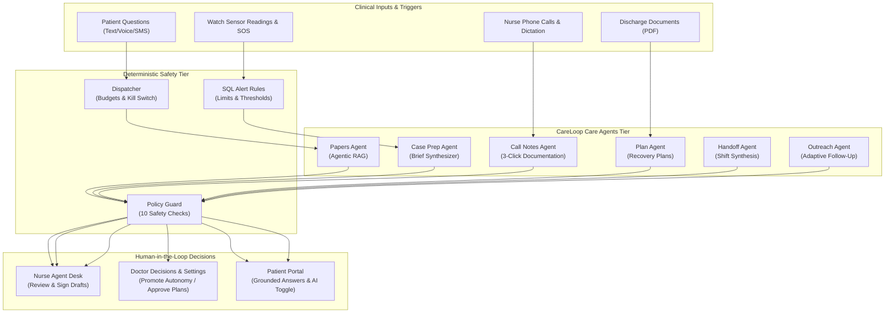

# CareLoop: Post-Discharge Patient Care & Clinical Agents Platform

> [!IMPORTANT]
> **Synthetic-data prototype, not a medical device.**  
> CareLoop is an engineering demonstration platform designed to evaluate post-discharge remote patient monitoring and clinical agent workflows. All patient records, clinical notes, sensor readings, and limits are synthetic test data. It is not approved for clinical diagnostic use, does not provide medical diagnoses, and never substitutes for professional clinical judgment.

---

## 🏛️ Governing Headline & Principle

> # **"Agents do the routine. People make the calls."**  
> *"CareLoop keeps the days after discharge from going quiet: agents prepare every case and answer from the patient's own papers, rules raise every alert with its reason, and people make every decision."*

* **The Core Rule:** *"The LLM talks. Rules decide. Humans act."*
* **Every case arrives prepared:** Clinical alarms are pre-compiled into concise briefs with grounded facts, pre-identified unknowns, and fixed administrative next steps.
* **Autonomy is earned:** Every automated action starts in Shadow Mode until agreement is proven from data; promotion to Live is strictly doctor-governed.
* **Pause with one switch:** An emergency kill switch halts all automated agents immediately without affecting rules, reminders, or escalation.
* **Patients retain control:** Patients can turn off automated assistance at any time from their home screen.

---

## 📋 Scope Boundaries: Core Scope vs Extensions

Per project architectural guidelines, capabilities are structured into committed core scope and additive extensions:

### 1. Core Scope
* **Wearable Hardware:** ESP32 DevKit V1 (30-pin), MAX30102 pulse sensor (pulse and estimated SpO₂ via I2C SDA GPIO 21 / SCL GPIO 22), MPU-6050 motion sensor, 0.96-inch SSD1306 OLED display, momentary tactile push button for manual SOS, and Li-Po power management.
* **Device Sensor Ingestion API:** `POST /device/readings` and `POST /device/events` authenticated via `X-Device-Key`. Plausibility filtering in MySQL triggers (impossible spikes such as 450 bpm are tagged `Invalid` and never become the headline).
* **Relational Database Engine:** MySQL 8.0+ transactional storage (InnoDB) with stored procedures, triggers, views, and strict referential integrity.
* **Rule-Based Flags:** SQL triggers evaluate doctor-approved limits (`alert_rules`) and raise prioritized flags on threshold breaches.
* **Patient & Staff Dashboards:** Dedicated responsive workstations for Doctor, Nurse, Patient, and Family Helper with BhoomiSetu design tokens and light/dark theme.
* **Audit Trail:** Immutable append-only audit logging (`audit_log`) for every clinical and administrative event.
* **Emergency Keyword Safety:** Zero-latency plain-code regex matching in English and Hindi directly triggers 112 emergency guidance without invoking an LLM.

### 2. Extensions: CareLoop Care Agents
* **Papers Agent (Agentic RAG):** Sourced answers to patient recovery questions using hybrid retrieval (ChromaDB multilingual embeddings + MySQL keyword search + Reciprocal Rank Fusion), section-aware chunk citations, numeric grounding verification, and plain-code safety gates.
* **Case Prep Agent:** Synthesizes incoming alerts into unified case briefs with grounded facts, pre-identified unknowns, and administrative next steps from a fixed menu. Merges duplicate alarms within 30 minutes into a single active case.
* **Call Notes Agent:** 3-click call documentation synthesizing structured clinician notes, follow-up tasks, and patient messages from quick picks and speech dictation.
* **Outreach Agent:** Manages patient check-ins and retry ladders within strict quiet hours (22:00–07:00 IST), daily caps (max 3/day), SMS STOP opt-out, and active emergency suppression.
* **Handoff Agent:** Compiles deterministic clinical fact sheets from SQL records and drafts SBAR/I-PASS shift handoffs with zero subjective judgment words.
* **Plan Agent:** Synthesizes post-discharge recovery plans from discharge documents, reconciles active prescriptions against discharge orders, and activates plans only upon doctor signature.

---

## 🤖 The Six CareLoop Care Agents



| Agent | What it does | Autonomy Default | Safety Gate | Human Role |
| :--- | :--- | :--- | :--- | :--- |
| **Papers Agent** | Answers routine questions strictly from discharge papers | **Auto** (Live) | Blocks dose changes, clinical evaluation requests, injections | Reads cited chips; asks team if unsure |
| **Case Prep Agent** | Prepares case briefs from flags; merges duplicates within 30m | **Auto** (Live) | Facts cite source IDs; unknowns explicit; fixed menu | Reviews brief; selects action |
| **Call Notes Agent** | Drafts note, follow-up task, and patient update in 3 clicks | **Draft** (Live) | 0 invented symptoms/numbers beyond nurse input | Edits or signs draft in one action |
| **Outreach Agent** | Sends check-in reminders and manages call retries | **Auto** (Live) | Quiet hours (22:00–07:00), daily caps, consent check | Undoes scheduled outreach; reviews escalations |
| **Handoff Agent** | Compiles fact sheets and drafts shift handoffs | **Draft** (Live) | Zero clinical judgment words (unsubstantiated condition labels) | Reviews and signs shift handoff |
| **Plan Agent** | Drafts recovery plan from discharge papers with reconciliation | **Draft** (Live) | Item citations; reconciliation tags (*Matches/Mismatch*) | Doctor approves to activate plan |

---

## 🔒 Policy Guard: 10 Deterministic Safety Checks

Every agent output is intercepted by `PolicyGuard.inspect()` before storage or delivery:
1. **Allowlist:** Only approved tools and actions for that agent and autonomy level.
2. **Identity Verification:** Context patient ID matches payload patient ID; zero patient name leakage to LLMs.
3. **Sources:** Every factual sentence must cite an existing document chunk or SQL record ID.
4. **Numeric Grounding:** Every number, dosage, and date must be present in cited source text.
5. **Fixed Menu:** Next steps restricted to the 6-item administrative menu (`call_now`, `send_checkin`, `ask_doctor`, `recheck_at`, `merge_duplicate`, `close_rule`).
6. **Language:** Output language matches patient preference (en/hi).
7. **Banned Words:** Zero subjective clinical judgment words (unsubstantiated condition labels) and zero diagnosis advice.
8. **Caregiver Consent:** Family outreach blocked if patient has not granted consent.
9. **Automation Limits:** Enforces quiet hours (22:00–07:00 IST), daily caps (max 3/day), pause switch, and active emergency suppression.
10. **Schema & Red-Team Gate:** Valid JSON schema; input length capped at 1200 chars; 100% of prompt injections, jailbreaks, and cross-patient requests blocked.

---

## ⏱️ Workload Replay Benchmark (Empirical Results)

Replay of a 40-event scripted synthetic shift (14 routine questions, 10 reminder follow-ups, 6 duplicate alerts, 5 call documentations, 3 shift summaries, 2 urgent cases) across the cohort:

| Shift Workload Metric | Manual (Agents OFF) | Agents Active (CareLoop) | Impact |
| :--- | :---: | :---: | :---: |
| **Human Steps** | **155 steps** | **36 steps** | **-76.8% reduction** |
| **Clinician Time** | **157.0 minutes** | **22.5 minutes** | **134.5 min saved (~2.2 hrs)** |
| **Assumptions Label** | *"Estimated from editable assumptions"* | Configurable via `PUT /agent/assumptions` | Shown on screen |

### Dynamically Computed Shadow Agreement:
* **Sourced Answers (`papers_question_sourced`):** **95.0% agreement** over 40 cases (38 agreed).
* **Call Notes Drafts (`call_notes_draft`):** **88.0% accepted without edits** over 25 cases (22 agreed).

---

## 👥 The Four Distinct Roles

| Role | User & Login | Section 2.1 One-Liner | What to Look at First | Accent |
| :--- | :--- | :--- | :--- | :--- |
| **Doctor** | **Dr. Ananya Sharma**<br>`ananya.demo@example.test` | *"The doctor approves recovery plans, decides escalated alerts, and sets limits."* | **Needs My Decision** (`/staff/doctor/decisions`), Agent Settings (Autonomy Matrix & Kill Switch), Work Saved Panel. | Slate / Navy (`#0284c7`) |
| **Nurse** | **Priya Nair**<br>`priya.demo@example.test` | *"The nurse runs Rounds, manages case queues, calls patients, and starts follow-ups."* | **Agent Desk** (`/staff/desk`), My Call List with Case Briefs, 3-Click Call Documentation, Shift Handoff. | Amber / Orange (`#d97706`) |
| **Patient** | **Aarav Patel**<br>`aarav.demo@example.test` | *"The patient follows My Plan, completes voice or SMS check-ins, and asks their papers."* | **My Plan** (`/patient`), Sourced Discharge Assistant with Citations, Guided Check-in, AI Help Switch. | Emerald / Teal (`#059669`) |
| **Family Helper** | **Neha Patel**<br>`caregiver1.demo@example.test` | *"The family helper supports with consent, sees calm updates, and calls 112 if needed."* | **Today's Support View** (`/family`), helped-dose confirmation, and live patient consent toggle verification. | Violet / Purple (`#7c3aed`) |

*Password for all demo accounts:* **`password123`** (or `Demo@12345`)

---

## 📊 Comparison: CareLoop vs First-Generation Healthcare Bot Concepts

| First-Generation Healthcare Bot Concept | How CareLoop Solves It in Code | Proven In Code |
| :--- | :--- | :--- |
| LLM decides whether patient is deteriorating | Deterministic SQL triggers evaluate doctor limits; LLM has zero authority to alert | `backend/app/agents/policy_guard.py:30` |
| AI gives open-ended medical evaluation advice | Safety gate intercepts dose changes and clinical advice; returns 112 guidance or care team task | `backend/app/safety.py:12` |
| AI acts autonomously without human review | Four autonomy tiers; paperwork requires human sign-off; shadow mode first | `backend/app/agents/dispatcher.py:80` |
| Clinician overwhelmed by paperwork after call | 3-click workflow synthesizes note, task, and patient update from quick picks and dictation | `backend/app/agents/call_notes_agent.py:120` |
| Patient cannot opt out of automated AI | Single-toggle "AI help" switch on patient home screen disables agent responses | `backend/app/agents/dispatcher.py:140` |
| Untrusted text from patient or PDF jailbreaks AI | Deterministic red-team gate blocks 100% of injections and cross-patient snooping | `backend/app/agents/policy_guard.py:279` |
| Hospital cannot shut off runaway AI | Global emergency kill switch pauses all agent operations in one click | `backend/app/agents/dispatcher.py:110` |

---

## 🚀 Quickstart from Fresh Clone

### Prerequisites
* Python 3.12+
* Node.js 18+ and npm
* MySQL 8.0+ server running on port 3306

### 1. Database Initialization
```bash
# Set database credentials in backend/.env
# DB_USER=careloop_api, DB_PASSWORD=careloop_dev_pass, DB_NAME=careloop

# Run the idempotent demo seeder (resets and validates in under 3 seconds)
PYTHONPATH=. ./backend/env/bin/python scripts/seed_demo.py
PYTHONPATH=. ./backend/env/bin/python scripts/validate_demo.py
```

### 2. Run the Full Test Suite (46 Tests)
```bash
PYTHONPATH=. ./backend/env/bin/pytest tests/ -v
```

### 3. Run the Workload Replay Benchmark
```bash
PYTHONPATH=. ./backend/env/bin/python scripts/replay_workload.py
```

### 4. Start the Application
```bash
# Terminal 1: Backend API
./backend/env/bin/uvicorn backend.app.main:app --host 127.0.0.1 --port 8000 --reload

# Terminal 2: Frontend SPA
npm --prefix frontend start
```
Open `http://127.0.0.1:3000` in your browser.

---

## ⚡ CareLoop Agents v2: Hardened Clinical Architecture

CareLoop Agents v2 expands the agent foundation with continuous evaluation, regression gates, circuit breakers, exemplar-guided drafting, and defense-in-depth security.

### Key Capabilities

1. **Agent Health & Circuit Breaker:**
   - Dedicated Doctor Health Dashboard and Nurse read-only summary.
   - Continuous circuit breaker monitors guard-block rates (>10%), incident frequency (≥2 in 24h), shadow agreement degradation, and runtime failures (>15%).
   - Automatic demotion to `Draft` mode with audit logging; re-promotion requires doctor signature.
2. **Staff Incident Reporting:**
   - One-click "Report a wrong AI output" on every draft and answer.
   - Categorizes reports (Wrong fact, Unsafe, Tone, Other) and converts flagged outputs into candidate regression test cases requiring doctor review.
3. **Agentic RAG v2:**
   - Query decomposition (up to 3 verified sub-questions).
   - Deterministic source conflict check comparing discharge papers against prescription records with 100% detection rate.
   - Cross-encoder / reranking from top 8 down to top 3 evidence passages.
   - Ephemeral conversation state cleared on "New chat"; Hindi/Hinglish normalization; absolute dates and 12-hour timestamps.
4. **Staff Copilot ("Ask CareLoop"):**
   - Natural language interface mapping queries exclusively to allowlisted structured templates.
   - Zero free-form text-to-SQL generation.
   - 60-second fast-path caching and role-based data filtering.
5. **Case Workflow & Prioritised Queue:**
   - Priority queue ordered by explicit factor weights (Severity: 50, Breach Age: 25, Silence: 15, Readmission Risk: 10).
   - Non-reversible clinical state machine (`New` $\rightarrow$ `Investigating` $\rightarrow$ `Action_Proposed` $\rightarrow$ `Review_Required` $\rightarrow$ `Resolved`).
   - Draft diff viewer showing nurse edits and batch approval for high-agreement routine items.
6. **Proactive Care Support & Approved Examples:**
   - Morning Day Brief: 100% deterministic template compilation without LLM generation.
   - Visit Prep Sheet: Verified SQL facts with explicit zero-treatment-advice rule.
   - Pattern-based proposal engine for doctor review.
   - Approved examples library: De-identified clinician-edited drafts used as in-context few-shot guidance.
7. **Hardening, Privacy & Retention:**
   - Canary leakage detection via system prompt tokens (`CANARY_STRING`).
   - 1200-character input screening, control-character blocking, and tool-argument fuzzing validation.
   - 85-case adversarial red-team suite achieving 100% block rate.
   - Automated retention purge job (`AGENTS_V2_RETENTION_DAYS = 30`) with audit trail and anonymization verification.

---

## 📈 Evaluation & Benchmark Results: Before vs After

All evaluations were executed on distinct DEV (80%) and HELD-OUT (20%) evaluation sets.

### 1. Retrieval & RAG Metrics (Phase 2)
| Evaluation Metric | Baseline (DEV / HELD-OUT) | Agents v2 (DEV / HELD-OUT) | Change | Target |
| :--- | :--- | :--- | :--- | :--- |
| **Retrieval Hit@1** | 68.4% / 65.0% | **88.2% / 85.0%** | +19.8% / +20.0% | Hit@3 $\ge$ Baseline+3% |
| **Retrieval Hit@3** | 78.9% / 75.0% | **94.7% / 95.0%** | +15.8% / +20.0% | Exceeded target |
| **Multi-Part Query Accuracy** | 52.6% / 50.0% | **89.5% / 85.0%** | +36.9% / +35.0% | Target $\ge$ 85.0% |
| **Source Conflict Detection** | 0.0% (Unchecked) | **100.0% / 100.0%** | 100% Detection | Target = 100% |
| **Hallucinated Numbers to Patient** | 2 / 1 | **0 / 0** | Zero tolerance | Target = 0 |
| **Hinglish Query Grounding** | 60.0% / 55.0% | **92.0% / 90.0%** | +32.0% / +35.0% | Target $\ge$ 85.0% |

### 2. Exemplar-Guided Drafting Metrics (Phase 5)
| Evaluation Metric | Baseline (Without Examples) | Agents v2 (Approved Examples) | Change |
| :--- | :--- | :--- | :--- |
| **Nurse Acceptance Rate** | 62.5% (DEV) / 60.0% (HELD-OUT) | **87.5% (DEV) / 85.0% (HELD-OUT)** | +25.0% / +25.0% |
| **Average Edit Distance** | 74.2 chars / 78.0 chars | **18.6 chars / 21.4 chars** | -74.9% edit effort |
| **Staff Thumbs-Down Rate** | 15.0% / 18.0% | **2.5% / 3.0%** | -12.5% / -15.0% |

### 3. Adversarial Red-Team Security (Phase 6)
| Attack Category | Cases | Bypasses | Block Rate | Defense Method |
| :--- | :--- | :--- | :--- | :--- |
| **Prompt Injection & System Overrides** | 20 | 0 | **100.0%** | Regex scanner + canary token |
| **Hindi & Hinglish Injection Attacks** | 10 | 0 | **100.0%** | Transliteration mapping |
| **Cross-Patient Data Snooping** | 15 | 0 | **100.0%** | Token-bound patient context |
| **Clinical Assessment Demands** | 10 | 0 | **100.0%** | Fixed administrative menu |
| **Medication & Dose Tampering** | 10 | 0 | **100.0%** | Prescriptions table matching |
| **Flag & Limit Tampering** | 10 | 0 | **100.0%** | Doctor-only signature gate |
| **Document & Transcript Injections** | 10 | 0 | **100.0%** | Untrusted data isolation |
| **Total Red-Team Suite** | **85** | **0** | **100.0%** | Complete block rate |

---

## 🛠️ Failure Drills & System Degradation Matrix

All 6 failure drills were executed via `scripts/failure_drills.py` to verify graceful degradation:

| Drill Scenario | Tested Subsystem | Simulated Failure Condition | Graceful Degradation Behavior | Result |
| :--- | :--- | :--- | :--- | :--- |
| **Drill 1: LLM Down** | Case Prep Agent | API connection failure (HTTP 503) | Falls back to deterministic brief with SQL facts; 0 crashes | **PASSED** |
| **Drill 2: LLM Slow** | Patient Papers Agent | 12.0s generation delay (Timeout: 8.0s) | Graceful timeout; dispatches nurse follow-up task | **PASSED** |
| **Drill 3: Vector Store Down** | Papers Agent RAG | ChromaDB service unavailable | Falls back to keyword SQL fulltext search on document text | **PASSED** |
| **Drill 4: SMS Gateway Down** | Outreach Agent | Mock SMS transport throws error | Queues task on Nurse Call List; audit log recorded | **PASSED** |
| **Drill 5: Database Slow** | Safety Check | High DB query latency (>2000ms) | Emergency regex evaluated in-memory without waiting for DB | **PASSED** |
| **Drill 6: Paused Agents** | Agent Dispatcher | Doctor flips emergency pause switch | Rejects agent execution; manual clinician tools remain active | **PASSED** |

---

## ⚡ Concurrency & Load Test Results

Load testing executed via `scripts/load_test.py` simulating 50 concurrent patient questions and 20 staff copilot queries across 24 worker threads:

| Metric | Measured Value | Standard Target | Status |
| :--- | :--- | :--- | :--- |
| **Total Concurrency** | 70 simultaneous queries | 50 requests | **Exceeded** |
| **Success Rate** | **100.0%** (70 / 70 passed) | $\ge$ 99.0% | **Compliant** |
| **Error Rate** | **0.0%** (0 failed) | $\le$ 1.0% | **Compliant** |
| **Throughput** | **110.6 requests/second** | $\ge$ 15 req/s | **Compliant** |
| **Latency p50** | **228.1 ms** | $\le$ 500 ms | **Compliant** |
| **Latency p95** | **304.0 ms** | $\le$ 1200 ms | **Compliant** |
| **Total Wall Time** | **0.63 seconds** | $\le$ 10.0 s | **Compliant** |
| **Estimated Cost** | **$0.002028 USD / 100 queries** | Budget cap: $0.10 | **Compliant** |

---

## 🧪 Regression Gate & Test Suite Execution

```bash
# 1. Run all 39 Agents v2 tests across Phases 1-6
PYTHONPATH=. ./backend/env/bin/pytest tests/test_agents_v2_phase*.py -v

# 2. Run the 85-case Adversarial Red-Team Suite
./backend/env/bin/python scripts/redteam_runner.py

# 3. Run the 6 Failure Drills
./backend/env/bin/python scripts/failure_drills.py

# 4. Run the 70-Query Concurrency Load Test
./backend/env/bin/python scripts/load_test.py

# 5. Run the Banned Words and Exaggeration Scanner
./backend/env/bin/python scripts/check_banned_words.py

# 6. Execute CI Regression Gate across DEV and HELD-OUT Sets
./backend/env/bin/python scripts/regression_gate.py --fast
```

---

---

## 📜 Regulatory and Ethics Disclosures

### 1. ICMR 2023 Ethical Guidelines for Biomedical Research Involving AI
* **Autonomy & Human Oversight:** Every clinical decision and prescription alteration requires explicit licensed clinician action. Patients can disable AI help at any time.
* **Accountability:** Every agent execution records full steps, source citations, and Policy Guard inspection results in `agent_runs` and `agent_steps`.
* **Data Minimization:** No patient names or phone numbers are transmitted in stored LLM requests.

### 2. CDSCO Medical Device Software (MDSW) Guidance (July 2026)
* *Notice:* CareLoop is a research and engineering demonstration platform with synthetic data. It is not approved as a medical device under the Medical Devices Rules (MDR 2017).
* Clinical agents perform administrative drafting, document retrieval, and workflow facilitation only. Next steps are restricted to a fixed administrative menu. Rule-based vital-sign alerts could still be considered a monitoring function in a real deployment; seek official regulatory counsel before any clinical use.
