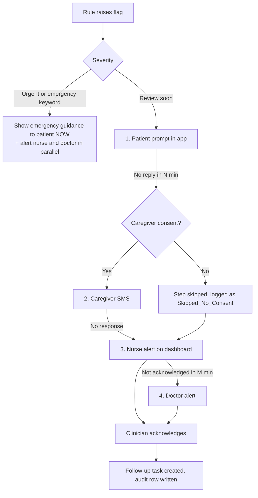
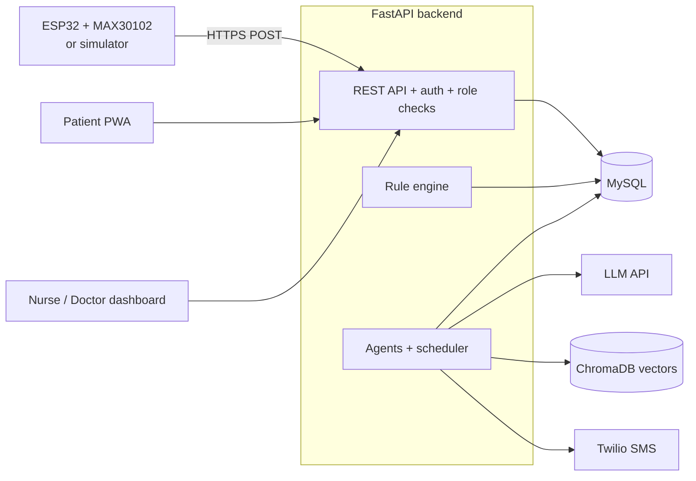
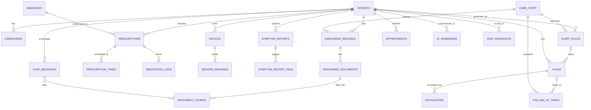

# CareLoop: Complete Project Master Document
### Agentic Post-Discharge Care System: proposal, full feature list, build guide and database reference

**Project type:** Hackathon prototype + college DBMS project (same project)
**Database file:** `careloop_mysql_v2_detailed.sql` (MySQL 8.0.16+; 25 tables, 7 views, 8 procedures, 3 triggers, 2 events, synthetic seed data, demo queries Q1-Q29)
**Guiding rule:** *The LLM talks. Rules decide. Humans act.*

> **Honest status.** This is a proof of concept with **synthetic data**, not a medical device. The SQL and code were written carefully but **not executed** in the environment where they were produced: run them, read errors, and fix. Thresholds, timings, keyword lists and the priority-score weights are **demo values** that real clinicians would have to set and validate. Library APIs change; check current documentation when a snippet does not match.

## How this document is organised

| Part | Contents | Use it to |
|---|---|---|
| **A** | Concept, keep/add/cut decisions, problem, agents, architecture, hardware and budget, database design, normalisation, API list, plan, demo script, safety, limits, pitch | Understand and present the project |
| **B** | **Complete feature catalog** (38 features + stretch/future), roles and permissions, end-to-end scenarios, extra code, non-functional requirements, report outline, checklists, glossary | Know exactly what to build and how to prove it |
| **C** | Detailed start guide: tools, repository layout, milestones M0-M6, starter code (backend, simulator, ESP32, RAG, scheduler, escalation), frontend plan, day plan, tests, troubleshooting | Start coding |
| **D** | Index of every database object and demo query | Prepare the report and demo |

Section numbers carry a part prefix (A7, B1, C5, D4) so references are unambiguous. Inside Part C, "section C9" means section 9 of Part C.

**Suggested reading order:** A1-A5 (idea), B1 (features), C3-C5 (setup), then build milestone by milestone.

**Inspiration note:** the agentic features were inspired by the public hackathon project *agentic-ai-nurse* (README-level review only). Build your own implementation and credit it as inspiration if asked.

---

# PART A. PROPOSAL, CONCEPT AND DATABASE DESIGN

## A1. What this version is

Version 1 was a solid DBMS project with a basic IoT and dashboard idea. The public project *agentic-ai-nurse* (Pranav-Rajput5, hackathon prototype) had the "wow" layer: AI agents, RAG over discharge documents, automatic escalation to family and doctors, and a triage dashboard. CareLoop v2 merges the two.

> Only the concept and feature list of the public repo were reviewed (README level). Build your own implementation; do not copy its code. Mention it as inspiration if asked.

**One-sentence pitch:** CareLoop is a safety-first AI follow-up assistant for patients who have just left hospital. It reminds them, listens to them, watches a low-cost wearable, escalates through a consent-aware ladder when something needs attention, and hands clinicians a prioritised, explainable queue, all backed by an auditable MySQL database.

**The principle that makes it defensible to judges:**

> **The LLM talks. Rules decide. Humans act.**
> The AI never diagnoses, never changes doses, and never decides who is "at risk". Clinician-approved rules raise flags, humans respond, and every autonomous action is logged.

---

## A2. Keep / Add / Cut decisions

| Decision | Feature | Why |
|---|---|---|
| **Keep** | MySQL relational core, ER design, normalisation | The DBMS submission. |
| **Keep** | ESP32 + MAX30102 (heart rate, SpO₂) | One sensor is enough for a convincing IoT demo. |
| **Keep** | Medication reminders + self-reported confirmation | Core patient value. |
| **Keep** | Symptom check-ins (text, optional voice-to-text) | Core patient value. |
| **Keep** | Doctor/nurse dashboard with review reasons | Core clinician value. |
| **Keep** | Patient chatbot with RAG over discharge summary | From the agentic repo; strongest AI feature. |
| **Keep** | Escalation ladder (patient, caregiver, nurse, doctor) | From the agentic repo; strongest "agentic" feature. |
| **Add** | **Consent-gated caregiver step** | Privacy by design; the ladder skips caregivers who have not consented. |
| **Add** | **Clinician-approved, per-patient alert rules** | Replaces "AI decides"; every flag shows its rule and reason. |
| **Add** | **Emergency keyword layer (deterministic code)** | Emergency guidance must not depend on an LLM. |
| **Add** | **Cited answers + safe refusal** | Chat answers show their source chunk or refuse (e.g. dose changes). |
| **Add** | **Device heartbeat and missing-data flag** | Silence is never treated as "normal". |
| **Add** | **Rule-based priority score (explainable)** | Orders the triage board; shows contributing factors. |
| **Add** | **Daily AI draft summary, clinician-reviewed** | Saves clinician time; marked as draft until reviewed. |
| **Add** | **Audit log of every agent action** | Trust and accountability. |
| **Add** | **Hindi + English** | Real reach in India; cheap to demo. |
| **Add** | **Simulator mode for the device** | Demo never fails if hardware misbehaves. |
| **Cut (for now)** | Temperature sensor, OLED display, MQTT | Not needed to prove the idea. |
| **Cut (for now)** | MongoDB + Firebase | One database (MySQL) is simpler and fits the DBMS marks. |
| **Cut (for now)** | Wound-photo analysis, audio (Librosa) analysis | Heavy, hard to validate, easy to over-claim. Listed as stretch. |
| **Cut (for now)** | Fall detection | Needs more hardware and testing. Future scope. |
| **Cut (for now)** | PDF export, advanced charts | Use a simple report page. |

---

## A3. Problem statement

After discharge, patients must follow medicines, watch symptoms and attend follow-ups, usually without a structured way to report back. Clinicians see them only at the next visit or when someone phones. Information is scattered, missing data is invisible, and caregivers are either not informed or informed without consent.

**Core question:** How can recovery information be easier for patients to record and easier for authorised staff to review, so follow-up effort goes where it is needed first?

**Users:** patients, consented caregivers, nurses, doctors.

---

## A4. Features (MVP scope)

### A4.1 Must-have (build first)
1. **Patient app (PWA/web):** today's doses with Taken / Skipped buttons, symptom check-in (text, optional voice), pain 0-10, recent readings, device status, follow-up date, emergency guidance.
2. **Reminder agent:** generates the day's dose events from the prescription times and sends SMS reminders. After a grace period, unconfirmed doses become "Missed" (meaning *no confirmation received*, not proof of non-consumption).
3. **Device ingestion:** ESP32 (or simulator) posts readings with a quality label; duplicates are rejected; impossible values are stored as Invalid.
4. **Rule engine:** clinician-approved thresholds per patient create **flags** with a visible reason.
5. **Triage dashboard:** open flags sorted by severity, reason, minutes open, priority score; acknowledge button creates a follow-up task.
6. **Escalation agent:** ladder with timeouts and consent checks, fully logged.

### A4.2 Should-have (build if time allows)
7. **RAG chatbot** over the patient's own discharge documents, with citations and a refusal path.
8. **Symptom tagging** (LLM extracts tags such as "fatigue"; the tag source is stored).
9. **Daily AI draft summary** for the clinician.
10. **Hindi/English** interface and chat.

### A4.3 Stretch
Wound-photo upload (stored for clinician viewing only, no AI diagnosis), BLE via phone, WhatsApp channel.

---

## A5. The agents

| Agent | Triggered by | Does | May NOT do |
|---|---|---|---|
| **Reminder agent** | Scheduler | Generates dose events, sends reminders, marks unconfirmed doses Missed after grace period | Claim a dose was or was not taken |
| **Check-in agent** | Patient report | Collects symptoms in Hindi/English, runs the **keyword emergency check in plain code**, asks an LLM to extract tags | Diagnose or reassure |
| **Q&A (RAG) agent** | Patient question | Answers only from the patient's discharge documents, cites chunks, refuses otherwise and notifies staff | Answer from general knowledge, advise on dose changes |
| **Escalation agent** | New flag | Walks the ladder, respects caregiver consent, logs every step | Skip consent, contact anyone outside the ladder |
| **Summary agent** | Daily schedule | Writes a factual draft from stored data | Recommend treatment; summaries stay "draft" until a clinician reviews |

### A5.1 Escalation ladder



Timeouts (N and M) are configuration values for the demo; real values must be set by a clinical team. If a notification fails, the failure is recorded and the next step proceeds.

---

## A6. Architecture



| Layer | Choice |
|---|---|
| Firmware | Arduino IDE / PlatformIO, MAX30102 library |
| Backend | Python FastAPI |
| Database | MySQL 8.0.16+ (single source of truth) |
| Vectors | ChromaDB (metadata and chunk text also in MySQL) |
| LLM | Any hosted LLM API behind one wrapper function (easy to swap) |
| Messaging | Twilio SMS (sandbox or trial for the demo) |
| Frontend | React (or plain HTML/JS if time is short) |

Keep one stack end to end. Credentials live on the server only, never in frontend code or firmware committed to a repo.

### A6.1 Hardware and budget (approximate, India)

| Item | Estimate |
|---|---:|
| ESP32 dev board | ₹300-500 |
| MAX30102 module | ₹150-350 |
| Breadboard + jumpers | ₹100-250 |
| USB cable / power | ₹100-300 |
| **Total** | **≈ ₹650-1,400** |

Wiring (verify against your board's documentation): VIN to the voltage your module supports, GND to GND, SDA to GPIO 21, SCL to GPIO 22 on many ESP32 boards. Optical readings are affected by motion, contact, light and module quality; label them as prototype values with a quality status, and never present them as clinically validated.

**Simulator:** a small Python script that posts plausible readings (marked `Simulated`) with the same API. Use it for development and as the live-demo fallback.

---

## A7. Database design (MySQL)

25 tables in six groups. Full DDL is in `careloop_mysql_v2_detailed.sql`.

| Group | Tables |
|---|---|
| People and access | `care_staff`, `patients`, `caregivers`, `user_accounts` |
| Discharge + RAG | `discharge_records`, `discharge_documents`, `document_chunks` |
| Medication | `medicines`, `prescriptions`, `prescription_times`, `medication_logs` |
| IoT | `devices`, `sensor_readings` |
| Symptoms + chat | `symptom_reports`, `symptom_report_tags`, `chat_messages`, `chat_message_sources` |
| Rules, escalation, care | `alert_rules`, `flags`, `escalations`, `follow_up_tasks`, `appointments`, `ai_summaries`, `risk_snapshots`, `audit_log` |

### A7.1 ER diagram



### A7.2 Normalisation: what was fixed from version 1

| Issue in v1 | Fix in v2 |
|---|---|
| `discharge_date` stored in both `patients` and `discharge_records` (redundant, update anomaly) | Kept only in `discharge_records` |
| `schedule_text` free text ("08:00 and 20:00") breaks 1NF and cannot drive reminders | `prescription_times`, one row per dose time; `sp_generate_daily_doses` builds events from it |
| `sensor_readings.patient_id` is derivable from the device (a transitive dependency) | Kept deliberately for fast queries, but guarded by a **composite foreign key** `(device_id, patient_id)` so it can never disagree with the device owner. Explain this as *controlled denormalisation* in your report |
| Risk level would depend on the score | Only `risk_score` is stored; the level is derived in a view |
| `flags.source_ref_id` points to different tables depending on `source_type` | No FK is possible (polymorphic reference). State this trade-off openly in the report |

### A7.3 DBMS concepts demonstrated

| Concept | Where |
|---|---|
| Primary / foreign / composite foreign keys | Everywhere; `sensor_readings` to `devices` |
| CHECK constraints | Pain 0-10, date order, account-role identity rule, rule parameters, confirmed-dose needs timestamp |
| UNIQUE constraints | Dose events, device readings (idempotent upload), tags, escalation steps |
| Many-to-many | `chat_message_sources` (answer to chunks) |
| Views | Triage board, latest readings, adherence, device status, pending follow-ups, latest risk, patient timeline |
| Window functions | `ROW_NUMBER()` for latest reading and latest risk snapshot |
| Joins, aggregates, subqueries | Demo queries Q1-Q29 (CTE, `NOT EXISTS`, `UNION ALL`, moving average) |
| Indexes + EXPLAIN | Patient/type/time index (Q16) |
| Stored procedures | Dose generation, missed-dose marking, rule evaluation, risk score, daily report, cursor-based risk run |
| **Transactions** | `sp_acknowledge_flag`: row lock, 4 writes, rollback on any error |
| **Triggers** | Sensor plausibility (BEFORE), reading rules and heartbeat (AFTER), symptom emergency and pain rules (AFTER) |
| Scheduled events | `ev_daily_dose_generation`, `ev_rule_engine_cycle` (created disabled) |
| JSON columns | Risk factors, audit details |
| Access control | App DB user without DELETE/DDL; role-based checks in the backend |
| Auditing | `audit_log` |

### A7.4 Explainable priority score

`score = min(100, 40 x open urgent flags + 20 x open review-soon flags + min(30, 10 x missed doses in 72 h) + 15 if max pain in 72 h is 7 or more)`
Level: 60 or more High, 30 or more Moderate, otherwise Low. The weights are demo values for ordering the review queue. They are **not** a clinical risk model, and the dashboard must show the contributing factors next to the number.

---

## A8. Key API endpoints (build list)

| Method + path | Who | Purpose |
|---|---|---|
| `POST /device/readings` | Device | Ingest reading (idempotent; rejects duplicates) |
| `GET /patient/me/doses` | Patient | Today's dose events |
| `POST /patient/me/doses/{id}/confirm` | Patient / caregiver | Taken or Skipped |
| `POST /patient/me/symptoms` | Patient | Check-in; backend runs emergency keyword check |
| `POST /patient/me/chat` | Patient | RAG question; returns answer + sources or refusal |
| `GET /staff/triage` | Nurse / doctor | Triage board |
| `POST /staff/flags/{id}/acknowledge` | Nurse / doctor | Calls `sp_acknowledge_flag` |
| `GET /staff/patients/{id}/timeline` | Nurse / doctor | Readings, symptoms, doses, flags |
| `GET /staff/summaries/pending` | Doctor | Draft summaries to review |

Every endpoint filters by the authenticated identity. A patient can read only their own rows.

---

## A9. Build plan (5 days; adapt to your hackathon length)

| Day | Goal |
|---|---|
| 1 | Run the SQL script. Draw the ER diagram. Skeleton FastAPI + login + role checks. Patient and staff page shells. |
| 2 | Device ingestion endpoint + simulator. ESP32 sending one real reading. Dose generation + confirm buttons. |
| 3 | Symptom check-in with emergency keyword layer. Rule engine via triggers and procedures. Triage dashboard reading `v_triage_board`. |
| 4 | Escalation agent with Twilio sandbox and consent check. Acknowledge flow. Audit log visible in UI. |
| 5 | RAG chatbot with citations and refusal. Daily draft summary. Hindi labels. Rehearse demo, take screenshots. |

**If you only have 3 days:** do Day 1-3 items plus the escalation ladder with a faked SMS (log only). Move the chatbot and summaries to "future scope". The demo still shows IoT, rules, triage and a real database.

**If you are alone:** use the simulator first, add real hardware last; skip Twilio by logging "SMS sent" rows until the end.

---

## A10. Five-minute demo script (synthetic data)

1. Patient "Meera" (Hindi interface) opens the app and sees today's doses.
2. She confirms one dose; one stays unconfirmed. Run the Reminder agent: it becomes **Missed** and a rule flag appears.
3. The ESP32 (or simulator) posts SpO₂ 91 %. The **trigger** raises an Urgent flag showing *"SpO2 reading 91 % is below the clinician-approved limit of 94 (simulated reading)"* (SQL Q6).
4. She submits a Hindi voice check-in. Show tags and that an emergency keyword test creates an immediate flag and on-screen emergency guidance (Q8).
5. Open the nurse dashboard: flags sorted by severity with reason and priority score (Q2).
6. Show the escalation ladder where the **caregiver step is skipped because consent was not granted** (Q9).
7. Nurse clicks **Acknowledge**; show the transaction result, new follow-up task and audit row (Q10, Q11).
8. Patient asks "When is my follow-up?" (cited answer), then "Can I double my dose?" (refusal + staff notified) (Q12, Q13).
9. Unplug the device. The dashboard shows **Missing data**, not a normal value (Q5).
10. Switch to MySQL Workbench and run the constraint tests (Q17) to show the database rejecting bad data.

---

## A11. Privacy, security and clinical safety

- Synthetic data only for demos; never real patient data in a public repo or demo.
- Authentication for every role; record-level authorisation in the backend; DB account with minimum privileges.
- Caregivers contacted only with recorded consent.
- Emergency guidance is shown immediately by deterministic code; the app never tells a patient to "wait for a doctor to call".
- LLM output never creates flags, changes prescriptions or gives diagnoses. RAG answers use only the patient's documents and show the source.
- Missing, questionable and invalid readings are labelled; a normal-looking reading is not proof of safety.
- All autonomous actions and clinician actions are written to `audit_log`.
- Real deployment would need clinical validation, privacy and regulatory review, validated devices, and defined responsibility for who reviews each flag and when.

---

## A12. Testing checklist

- Create patient, caregiver, prescription and dose events; no duplicates on re-run.
- Duplicate device upload rejected; impossible value stored as Invalid with no flag.
- Reading above/below approved limit creates exactly one open flag with the right reason.
- Missed-dose and no-data rules create flags; no duplicates while one is open.
- Emergency keyword creates an Urgent flag and shows guidance.
- Caregiver step skipped without consent.
- Acknowledge twice returns an error and leaves data unchanged.
- Patient A cannot read patient B's data through the API.
- Chat refuses dose-change questions and shows citations for grounded answers.
- Device offline shows "Missing data".
- LLM or SMS failure is logged and the ladder continues.

---

## A13. Limitations and honest claims

- Low-cost sensors are not clinically validated.
- "Taken" is a self-report; "Missed" means no confirmation.
- The system cannot diagnose or guarantee detection of complications.
- Thresholds and escalation timings in the demo are fictional; real ones must come from clinicians.
- The priority score orders a review queue; it is not a predictor of outcomes.
- Claim only what you tested: "prototype demonstrates...", never "reduces readmissions".

---

## A14. Future scope

Wound-photo upload for clinician review, fall detection, BLE through the phone for homes without Wi-Fi, offline sync, WhatsApp, more regional languages, validated medical devices, standards-based health data exchange (e.g. FHIR), usability testing and clinical evaluation.

---

## A15. How to run the SQL

1. Install MySQL 8.0.16 or newer and open MySQL Workbench.
2. Open `careloop_mysql_v2_detailed.sql` and read the header: it **drops and recreates** the `careloop` objects, so use a dedicated database.
3. Run the whole script. It uses `DELIMITER` blocks for procedures and triggers; Workbench handles this when running the full script.
4. Run Q19: it should report 25 tables, 7 views, 8 procedures, 3 triggers and 2 events.
5. Run demo queries Q1-Q16 and Q19-Q29 one at a time in order (Q6 onward change data; re-run the script to reset).
6. Run the commented constraint tests (Q17) individually; each should fail with an error.

> Note: the script was written carefully but could not be executed in my environment, so run it once yourself and tell me about any error line; fixing a syntax detail is usually a one-line change.

---

## A16. Presentation outline and likely judge questions

**Slides:** 1) Problem, 2) Solution and principle "LLM talks, rules decide, humans act", 3) Architecture, 4) Live demo, 5) Escalation + consent, 6) Database design and SQL highlights, 7) Safety and limits, 8) Roadmap.

**Likely questions**
- *"Is the AI diagnosing?"* No. Deterministic, clinician-approved rules raise flags; the LLM only converses from documents, tags text and drafts summaries for review.
- *"What if the LLM hallucinates?"* Answers must come from the patient's own document chunks with citations, otherwise it refuses and notifies staff; ungrounded answers are queryable (Q13).
- *"How accurate is the sensor?"* It is not claimed to be clinical; readings carry quality labels and a simulator is used for the demo.
- *"Why MySQL, not a document store?"* Strong constraints, joins, transactions and auditability for sensitive, interrelated records; vectors live in ChromaDB.
- *"Privacy?"* Consent-gated caregivers, role-based access, minimal DB privileges, audit log, synthetic data.


---

# PART B. COMPLETE FEATURE CATALOG

This part lists **every feature** of CareLoop in one place, with who uses it, which database objects and code it touches, its priority, and how to prove it works. Priority legend: **MVP** = build first, **Should** = build if time allows, **Stretch** = only after everything else, **Future** = describe in the report, do not build.

## B1. Feature table

### Patient-facing features

| ID | Feature | Used by | What it does | Main database objects | Implemented in | Priority | Proof |
|---|---|---|---|---|---|---|---|
| F-01 | Login and roles | All | Email + password, token, role checks (Patient, Caregiver, Doctor, Nurse) | `user_accounts` (role CHECK) | Backend auth | MVP | Wrong role gets HTTP 403 |
| F-02 | Today's doses + confirm | Patient | Shows each dose event; Taken or Skipped buttons | `medication_logs`, `prescription_times` | API + `sp_generate_daily_doses` | MVP | Q4, Q21 |
| F-03 | Dose reminders | Reminder agent | Sends a reminder shortly before each dose (app or SMS) and records `reminder_sent_at` | `medication_logs.reminder_sent_at`, `audit_log` | Scheduler job (B4) | MVP | Reminder row in audit log |
| F-04 | Symptom check-in | Patient | Free text (typed or voice transcript), pain 0-10, language | `symptom_reports` | API | MVP | Row appears; pain rule fires at the approved limit |
| F-05 | Emergency path | Patient | Emergency keywords (English/Hindi) show guidance immediately and raise an Urgent flag | `symptom_reports.emergency_keyword_hit`, trigger `trg_symptom_rules_after_insert` | `safety.py` + trigger | MVP | Q8 |
| F-06 | Symptom tags | Check-in agent | LLM proposes short tags (e.g. fatigue); source stored | `symptom_report_tags` | LLM wrapper | Should | Q27 |
| F-07 | Hindi + English | Patient | Interface text, guidance, reminders and chat in the preferred language | `patients.preferred_language`, `symptom_reports.language` | Frontend + backend strings | Should | Switch language and check emergency text |
| F-08 | Cited Q&A over discharge documents | Patient | Answers only from the patient's own documents and shows the source chunk | `discharge_documents`, `document_chunks`, `chat_messages`, `chat_message_sources` | `rag.py` + Chroma | Should | Q12 |
| F-09 | Safe refusal | Patient | Dose-change or out-of-document questions get a refusal and a staff task | `chat_messages.is_grounded`, `follow_up_tasks` | `safety.py`, `rag.py` | Should | Q13 |
| F-10 | Patient status page | Patient | Latest readings with quality label, device status, next appointment, emergency banner | `v_latest_sensor_readings`, `v_device_status`, `appointments` | API (B4) | MVP | Page shows "Missing data" when device is silent |

### Device and data-quality features

| ID | Feature | Used by | What it does | Main database objects | Implemented in | Priority | Proof |
|---|---|---|---|---|---|---|---|
| F-11 | Idempotent device ingestion | Device | Retried uploads never create duplicates | `UNIQUE (device_id, measurement_type, measured_at)` | `POST /device/readings` | MVP | Constraint test Q17d |
| F-12 | Reading plausibility guard | System | Impossible values stored as `Invalid`, never flagged clinically | trigger `trg_sensor_plausibility` | DB | MVP | Q7 |
| F-13 | Quality labels | System | Every reading is Good, Questionable, Invalid or Simulated | `sensor_readings.quality_status` | Device + DB | MVP | Quality visible in Q3 |
| F-14 | Device simulator | Developer | Same API as the watch; has a low-SpO₂ switch for the demo | n/a | `simulator.py` | MVP | Flag appears live |
| F-15 | ESP32 + MAX30102 firmware | Device | Heart rate each minute (SpO₂ added later) over Wi-Fi | `devices` | `.ino` sketch | MVP (HR), Should (SpO₂) | Reading arrives in table |
| F-16 | Heartbeat and missing-data detection | System | Device silence is shown and flagged, never treated as normal | `devices.last_seen_at`, `v_device_status`, `sp_evaluate_no_data_rules` | Trigger + procedure | MVP | Q5 |

### Rule engine and flags

| ID | Feature | Used by | What it does | Main database objects | Implemented in | Priority | Proof |
|---|---|---|---|---|---|---|---|
| F-17 | Clinician-approved rules | Doctor | Per-patient limits with approver and time | `alert_rules` | Doctor UI or SQL | MVP | Q25 shows coverage |
| F-18 | Reading rule | System | Above/below limit creates one open flag with exact reason | trigger `trg_sensor_rules_after_insert` | DB | MVP | Q6 |
| F-19 | Pain rule | System | Pain at or above limit creates a flag | trigger `trg_symptom_rules_after_insert` | DB | MVP | Insert pain 8 and inspect flags |
| F-20 | Missed-dose rule | System | N missed doses in a window creates a flag | `sp_evaluate_missed_dose_rules` | Procedure + scheduler | MVP | Seed flag for Meera |
| F-21 | No-data rule | System | Silent device longer than X hours creates a flag | `sp_evaluate_no_data_rules` | Procedure + scheduler | MVP | Seed flag for Kabir |
| F-22 | Flags with reason, severity, status | Staff | Open, Acknowledged, Resolved, Dismissed; every flag explains itself | `flags` | DB | MVP | Q2 |
| F-23 | Duplicate-flag protection | System | No second open flag for the same rule | `NOT EXISTS` inside triggers/procedures | DB | MVP | Send two low readings, one flag |

### Escalation and clinician workflow

| ID | Feature | Used by | What it does | Main database objects | Implemented in | Priority | Proof |
|---|---|---|---|---|---|---|---|
| F-24 | Escalation ladder | Escalation agent | Patient prompt, caregiver SMS, nurse, doctor, with timeouts | `escalations` | `escalation.py` | MVP | Q9 |
| F-25 | Consent-gated caregiver step | Escalation agent | Skipped and logged when consent is missing | `caregivers.consent_granted`, `Skipped_No_Consent` | `escalation.py` | MVP | Q9, Q26 |
| F-26 | Triage board | Nurse, Doctor | Flags by severity with reason, minutes open, priority score | `v_triage_board`, `v_latest_risk` | API + page | MVP | Q2 |
| F-27 | Atomic acknowledge | Nurse, Doctor | Locks flag, stops escalation, creates follow-up task, writes audit row, rolls back on error | `sp_acknowledge_flag` | DB transaction | MVP | Q10, Q17f |
| F-28 | Follow-up tasks | Nurse | Work queue created from flags | `follow_up_tasks`, `v_pending_followups` | DB + page | MVP | Q10, Q24 |
| F-29 | Appointments | Staff, Patient | Scheduled follow-ups shown to patient | `appointments` | API | Should | Next appointment on patient page |
| F-30 | Patient timeline | Staff | One chronological feed of readings, symptoms, doses and flags | `v_patient_timeline` | View + API | Should | Q20 |
| F-31 | Daily report | Staff | Five-section report for one patient and day | `sp_daily_report` | Procedure | Should | Q21 |
| F-32 | Adherence overview | Staff | Counts and self-reported taken % | `v_medication_adherence` | View | MVP | Q4 |

### Intelligence, trust and governance

| ID | Feature | Used by | What it does | Main database objects | Implemented in | Priority | Proof |
|---|---|---|---|---|---|---|---|
| F-33 | Explainable priority score | Staff | Additive score and level, with factors shown | `risk_snapshots`, `sp_compute_risk_snapshot`, `sp_compute_all_risk_snapshots` | Procedures + scheduler | Should | Q28 |
| F-34 | AI daily draft summary | Doctor | Factual draft, labelled until a clinician reviews it | `ai_summaries` | Summary agent | Should | Q15 |
| F-35 | Audit log | Admin | Every agent and staff action recorded | `audit_log` | Backend + procedures | MVP | Q11 |
| F-36 | Consent gating of monitoring | System | Only patients with consent `Granted` are scored | `patients.consent_status` | Cursor procedure | Should | Change a patient to Pending and rerun Q28 |
| F-37 | Least-privilege DB account | Admin | App user without DELETE or DDL | grants | SQL block | Should | Attempt DELETE as app user fails |
| F-38 | Record-level authorisation | Backend | Patient requests always filtered by the id inside the token | n/a | Backend | MVP | Change ids in URL: no leak |

### Stretch and future

| ID | Feature | Priority | Note |
|---|---|---|---|
| S-01 | Wound-photo upload for clinician viewing (no AI diagnosis) | Stretch | New table `wound_photos` with review status |
| S-02 | Per-device hashed API keys | Stretch | Column `devices.api_key_hash` already exists |
| S-03 | Staff-to-patient assignment filtering | Stretch | Use `discharge_records.attending_staff_id` for doctors |
| S-04 | WhatsApp channel | Stretch | Needs business API approval |
| S-05 | BLE through the phone | Stretch | For homes without Wi-Fi |
| S-06 | Caregiver view | Stretch | Read-only status, only with consent |
| S-07 | PDF/CSV report export | Stretch | From `sp_daily_report` |
| F-F1 | Fall detection, temperature | Future | More hardware and validation |
| F-F2 | Standards-based health data exchange (FHIR) | Future | Integration with hospital systems |
| F-F3 | More regional languages | Future | Needs multilingual embeddings and review |
| F-F4 | Statistical or ML risk models | Future | Only after clinical validation and ethics review |

## B2. Roles and permissions

| Action | Patient | Caregiver | Nurse | Doctor | Backend/agents |
|---|:-:|:-:|:-:|:-:|:-:|
| See own doses, readings, appointments | Yes | Only with consent | No | Own patients | n/a |
| Confirm or skip doses | Yes | On patient's behalf (recorded as Caregiver) | No | No | No |
| Submit symptom check-in and chat | Yes | No | No | No | n/a |
| See triage board | No | No | Yes | Yes | n/a |
| Acknowledge flags, manage follow-ups | No | No | Yes | Yes | n/a |
| Create or approve alert rules | No | No | No | Yes | n/a |
| Review AI summaries | No | No | No | Yes | Writes drafts only |
| Create flags | No | No | No | No | Only via rules, triggers and emergency check |
| Write audit log | Indirect | Indirect | Indirect | Indirect | Yes |
| Change prescriptions | No | No | No | Yes | **Never** |

## B3. End-to-end scenarios (use these as demo stories and as test cases)

**Scenario 1: Abnormal reading becomes a human action**
1. Device or simulator posts SpO₂ 91 for Meera. The unique key rejects duplicates.
2. The BEFORE INSERT trigger confirms the value is plausible, so quality stays Simulated/Good.
3. The AFTER INSERT trigger finds her approved rule (limit 94) and inserts one Urgent flag with the reason text.
4. Within a minute the escalation job writes steps: patient prompt, nurse alert, doctor alert, then caregiver SMS after 10 minutes if still open.
5. A nurse acknowledges on the triage board. `sp_acknowledge_flag` locks the flag, marks escalation rows acknowledged, creates a follow-up task and an audit row in one transaction.
6. The patient timeline now shows reading, flag and task in order.

**Scenario 2: Emergency wording in a check-in**
1. Patient writes an emergency phrase in Hindi or English.
2. Backend code (not the LLM) detects it, returns guidance instantly and stores `emergency_keyword_hit = TRUE`.
3. The trigger creates an Urgent flag. Escalation notifies nurse and doctor immediately.
4. Tag extraction by the LLM may run later; if it fails, nothing is lost.

**Scenario 3: Question the documents do not answer**
1. Patient asks "Can I double my dose today?".
2. The refusal pattern matches. No LLM call is made. The patient sees a refusal and a promise that staff were asked.
3. A follow-up task is created so the promise is true, and `chat_messages.is_grounded = FALSE` makes the case reportable (Q13).

**Scenario 4: Silence**
1. The simulator is stopped. `v_device_status` becomes `Missing_Data`.
2. After the rule's hours, `sp_evaluate_no_data_rules` creates a Device flag stating that missing data is not a normal reading.
3. Kabir's caregiver step is logged `Skipped_No_Consent`; the nurse step proceeds.

## B4. Gap-filling backend snippets

These complete features that Part C references but does not show. They are starter code, not tested.

**Login (F-01)**
```python
class LoginIn(BaseModel):
    email: str
    password: str

@app.post("/auth/login")
def login(b: LoginIn):
    acct = verify_login(b.email, b.password)
    if not acct:
        raise HTTPException(status_code=401, detail="Wrong email or password")
    return {"access_token": make_token(acct), "role": acct["account_role"]}
```

**Triage board (F-26)**
```python
@app.get("/staff/triage")
def triage(user=Depends(require_role("Doctor", "Nurse"))):
    with get_conn() as conn, conn.cursor() as cur:
        cur.execute("""SELECT * FROM v_triage_board
                       ORDER BY FIELD(severity,'Urgent_Review','Review_Soon','Info'), flagged_at""")
        return cur.fetchall()
```

**Patient timeline (F-30)**
```python
@app.get("/staff/patients/{pid}/timeline")
def timeline(pid: int, user=Depends(require_role("Doctor", "Nurse"))):
    with get_conn() as conn, conn.cursor() as cur:
        cur.execute("""SELECT event_time, event_type, summary FROM v_patient_timeline
                       WHERE patient_id=%s ORDER BY event_time DESC LIMIT 200""", (pid,))
        return cur.fetchall()
```

**Patient status page (F-10)**
```python
@app.get("/patient/me/status")
def my_status(user=Depends(require_role("Patient"))):
    pid = user["patient_id"]                       # always from the token, never from the URL
    with get_conn() as conn, conn.cursor() as cur:
        cur.execute("""SELECT measurement_type, measurement_value, unit, measured_at, quality_status
                       FROM v_latest_sensor_readings WHERE patient_id=%s""", (pid,))
        readings = cur.fetchall()
        cur.execute("SELECT device_id, connectivity_status, last_seen_at FROM v_device_status WHERE patient_id=%s", (pid,))
        devices = cur.fetchall()
        cur.execute("""SELECT appointment_date, appointment_type FROM appointments
                       WHERE patient_id=%s AND status='Scheduled' AND appointment_date >= NOW()
                       ORDER BY appointment_date LIMIT 1""", (pid,))
        appt = cur.fetchone()
    return {"readings": readings, "devices": devices, "next_appointment": appt}
```

**Dose reminders (F-03)**: add to `scheduler.py` and register with `s.add_job(send_due_reminders, "interval", minutes=1)`.
```python
from .escalation import send_sms

REMINDER_TEXT = {
    "en": "Time for your medicine ({t}). Please confirm in the app.",
    "hi": "आपकी दवा का समय ({t}) है। कृपया ऐप में पुष्टि करें।",
}

def send_due_reminders():
    with get_conn() as conn, conn.cursor() as cur:
        cur.execute("""SELECT ml.medication_log_id, p.phone, p.preferred_language, ml.scheduled_for
                       FROM medication_logs ml
                       JOIN prescriptions pr ON pr.prescription_id = ml.prescription_id
                       JOIN patients p ON p.patient_id = pr.patient_id
                       WHERE ml.status='Unconfirmed' AND ml.reminder_sent_at IS NULL
                         AND ml.scheduled_for <= NOW() + INTERVAL 5 MINUTE
                         AND p.consent_status='Granted'""")
        for d in cur.fetchall():
            text = REMINDER_TEXT[d["preferred_language"]].format(t=d["scheduled_for"].strftime("%H:%M"))
            send_sms(d["phone"], text)             # keep the text free of diagnosis details
            cur.execute("UPDATE medication_logs SET reminder_sent_at=NOW() WHERE medication_log_id=%s",
                        (d["medication_log_id"],))
            cur.execute("""INSERT INTO audit_log (actor_type, actor_id, action, entity_type, entity_id, details)
                           VALUES ('Agent','reminder_agent','SEND_REMINDER','medication_log',%s,
                                   JSON_OBJECT('channel','SMS'))""", (d["medication_log_id"],))
```

## B5. Non-functional requirements

| Area | Requirement | How CareLoop meets it |
|---|---|---|
| Safety | No AI diagnosis, no AI-created flags | Rules and triggers create flags; LLM output is text only |
| Privacy | Caregiver contact only with consent; minimum data in SMS | `consent_granted`, SMS wording |
| Integrity | No duplicate, impossible or orphan data | UNIQUE, CHECK, composite FK, triggers |
| Reliability | Retries and failures must not break the flow | Idempotent upload, SMS failure logged, ladder continues |
| Traceability | Know who or what did what | `audit_log`, `acknowledged_by_staff_id`, `approved_by_staff_id` |
| Performance | Fast dashboard queries | Composite indexes, range predicates, views |
| Usability | Simple for low-literacy and stressed users | Large buttons, Hindi, one primary action per screen |
| Honesty | Never over-claim accuracy | Quality labels, "prototype" wording |
| Portability | Easy to run on any laptop | One SQL file, one `.env`, simulator mode |

## B6. DBMS report outline (maps your project to submission chapters)

1. **Introduction and problem statement.** Part A sections 3-4.
2. **Requirements.** Feature tables in B1 (functional) and B5 (non-functional).
3. **ER diagram.** Part A section 7.1; export with Workbench Reverse Engineer.
4. **Relational schema.** Run Q29 and Q29b for the data dictionary and foreign key map.
5. **Normalisation.** Part A section 7.2 (the five fixes and the justified denormalisation).
6. **Integrity constraints.** Constraint tests Q17 a-f with screenshots of the errors.
7. **Views, procedures, triggers, events, transactions.** Appendix D tables plus Q6, Q7, Q8, Q10.
8. **Queries.** Q1-Q29 grouped by concept (joins, window functions, CTE, aggregates, set operations through `UNION ALL`, subqueries, `NOT EXISTS`).
9. **Security and privacy.** Part A section 11 and Part C section 15.
10. **Testing.** Part C section 13 checklist with results.
11. **Limitations and future scope.** Part A sections 13-14.
12. **Conclusion.**

## B7. Submission and demo-day checklist

- [ ] SQL script runs from a clean database; Q19 shows 25 / 7 / 8 / 3 / 2.
- [ ] Simulator and (if available) ESP32 both demonstrated; simulator is the fallback.
- [ ] Screenshots of ER diagram, triage board, escalation ladder, audit log, constraint errors.
- [ ] Every claim in the slides is something you actually tested.
- [ ] Synthetic data only; no secrets in the repository.
- [ ] Backup of the demo: recorded screen video and a printed copy of the demo script.
- [ ] Two team members can run the demo end to end.

## B8. Glossary

| Term | Meaning here |
|---|---|
| Flag | A system-generated reason for a human to review a patient. It is not a diagnosis |
| Rule | A clinician-approved, patient-specific limit stored in `alert_rules` |
| Escalation | Notification steps taken for an open flag, logged in `escalations` |
| RAG | Retrieval-augmented generation: the LLM sees only retrieved chunks of the patient's own documents |
| Grounded answer | An AI reply supported by cited document chunks |
| Idempotent | Repeating the same request has no extra effect |
| Heartbeat | The device's last-seen time, used to detect silence |
| Missed dose | No confirmation was received; it does not prove the dose was not taken |
| Consent gate | A check that blocks contact or monitoring unless consent is recorded |
| Denormalisation | Deliberate duplication for speed, here guarded by a composite foreign key |


---

# PART C. DETAILED START GUIDE

## C1. What you will have at the end of each milestone

| Milestone | You can demo | Proof (run this) |
|---|---|---|
| **M0** Database | Schema, seed data, triggers fire | SQL Q19 counts, Q2 triage board, Q6 trigger |
| **M1** Backend + login | Role-based API, Swagger page | `http://localhost:8000/docs` |
| **M2** Device data | Simulator (then ESP32) posting readings, flags appear | Q3, Q5, Q6 |
| **M3** Patient flows | Doses, symptom check-in, emergency path | Q8, Q4 |
| **M4** Escalation | Ladder with consent, acknowledge flow, audit log | Q9, Q10, Q11 |
| **M5** AI layer | Cited RAG answers, safe refusal, tags, draft summary | Q12, Q13, Q27 |
| **M6** Polish | Hindi labels, dashboard, rehearsed demo | Demo script in the proposal |

Do them **in order**. If time runs out after M4 you still have a complete, impressive project.

---

## C2. Tools to install

| Tool | Version | Used for |
|---|---|---|
| MySQL Server + Workbench | 8.0.16 or newer | Database |
| Python | 3.10+ | Backend, agents, simulator |
| Node.js | 18+ (only if you build React) | Frontend |
| Arduino IDE or PlatformIO | latest | ESP32 firmware |
| Git + VS Code | any | Code |
| Twilio account (trial) | - | SMS (optional until M4) |
| LLM API key (e.g. Google AI Studio) | - | Chat, tags, summaries (M5) |

---

## C3. Recommended repository layout

```
careloop/
├── database/
│   └── careloop_mysql_v2_detailed.sql
├── backend/
│   ├── .env                  # never commit
│   ├── requirements.txt
│   └── app/
│       ├── main.py           # FastAPI app + routes
│       ├── db.py             # connection helper
│       ├── auth.py           # login, JWT, role checks
│       ├── safety.py         # emergency keywords, refusal patterns
│       ├── escalation.py     # ladder logic + SMS
│       ├── rag.py            # chunking, Chroma, grounded answers
│       ├── llm.py            # single wrapper around the LLM API
│       └── scheduler.py      # periodic jobs
├── device/
│   ├── simulator.py          # fake device (use this first)
│   └── esp32_careloop/esp32_careloop.ino
├── frontend/                 # React or plain HTML pages
├── scripts/
│   ├── set_demo_passwords.py
│   └── index_document.py
└── docs/                     # ER diagram, screenshots, report
```

Add a `.gitignore` with `.env`, `.venv/`, `chroma/`, `__pycache__/`. **Never** commit API keys or Wi-Fi passwords.

---

## C4. Milestone M0: Database

1. Open MySQL Workbench, connect as a user that can create databases.
2. Open `careloop_mysql_v2_detailed.sql`, read the header, run the **entire** script (lightning icon, not the single-statement icon).
3. Run **Q19**. Expected: `25 tables, 7 views, 8 procedures, 3 triggers, 2 events`.
4. Run Q1-Q5, then Q6 (watch the trigger create a flag), Q7 (impossible value becomes Invalid), Q8 (emergency report creates an Urgent flag).
5. Re-run the whole script any time to reset data.

### C4.1 What every table is for (data dictionary)

| Table | Purpose | Written by | Read by |
|---|---|---|---|
| `care_staff` | Doctors and nurses | Admin | Everyone (names on dashboards) |
| `patients` | Patient profile, language, consent status | Admin / onboarding | All flows |
| `caregivers` | Family contacts with explicit consent flag | Patient / admin | Escalation agent |
| `user_accounts` | Logins; a CHECK ensures exactly one identity per role | Admin | Auth |
| `discharge_records` | Discharge date, condition summary, follow-up due | Doctor | Chat, dashboard |
| `discharge_documents` | Uploaded discharge files and indexing status | Backend | RAG |
| `document_chunks` | Text chunks used for citations (vectors live in Chroma) | Indexing script | RAG, chat |
| `medicines` | Medicine catalogue (fictional in demo) | Admin | Prescriptions |
| `prescriptions` | Which medicine, which patient, date range | Doctor | Dose generation |
| `prescription_times` | One row per daily dose time | Doctor | `sp_generate_daily_doses` |
| `medication_logs` | One row per dose event and its status | Procedure / patient | Reminder agent, adherence view |
| `devices` | Registered devices and last heartbeat | Admin / trigger | Device status view |
| `sensor_readings` | Heart rate / SpO₂ with quality status | Device endpoint | Rules, charts |
| `symptom_reports` | Patient check-ins, pain, language, emergency hit | Patient | Triggers, dashboard |
| `symptom_report_tags` | Structured tags and who produced them | Check-in agent | Search |
| `chat_messages` | Patient and AI-nurse messages, grounded or not | Chat endpoint | Audit |
| `chat_message_sources` | Which chunks supported which answer | RAG | Citations |
| `alert_rules` | Clinician-approved limits per patient | Doctor | Rule engine |
| `flags` | A reason for a human to look, with severity and status | Triggers / procedures | Triage board |
| `escalations` | Ladder steps taken for each flag | Escalation agent | Dashboard, audit |
| `follow_up_tasks` | Work items created when a flag is acknowledged | `sp_acknowledge_flag` | Nurses |
| `appointments` | Scheduled follow-ups | Staff | Patient app |
| `ai_summaries` | AI draft summaries awaiting review | Summary agent | Doctor |
| `risk_snapshots` | Explainable priority score history | Procedure | Triage board |
| `audit_log` | Every autonomous or human action | Backend / procedures | Review |

### C4.2 Where each business rule is enforced

| Rule | Enforced in |
|---|---|
| Pain score is 0-10 | DB CHECK |
| A reading can only be stored for the device's owner | DB composite FK |
| A retried device upload creates no duplicate | DB UNIQUE |
| Impossible sensor values are stored as Invalid, never flagged clinically | DB trigger |
| Reading above/below approved limit creates one open flag with a reason | DB trigger |
| Emergency keyword creates an Urgent flag | Backend detects, DB trigger flags |
| Caregiver contacted only with consent | Escalation code + DB column |
| A patient can read only their own data | **Backend** (never trust an id from the URL) |
| Acknowledging is atomic | DB procedure (transaction) |
| AI never creates flags or changes doses | **Backend design** (LLM output is text only) |

---

## C5. Milestone M1: Backend setup

```bash
cd careloop/backend
python -m venv .venv
# Windows: .venv\Scripts\activate      Mac/Linux: source .venv/bin/activate
pip install fastapi "uvicorn[standard]" pymysql python-dotenv pyjwt bcrypt apscheduler \
            twilio chromadb pypdf google-genai requests
pip freeze > requirements.txt
```

Create `backend/.env` (example values only):

```
DB_HOST=localhost
DB_PORT=3306
DB_USER=careloop_api
DB_PASSWORD=change_this
DB_NAME=careloop
JWT_SECRET=use-a-long-random-string
DEVICE_API_KEY=demo-device-key-change-me
TWILIO_ACCOUNT_SID=
TWILIO_AUTH_TOKEN=
TWILIO_FROM_NUMBER=
SMS_ENABLED=false
LLM_API_KEY=
LLM_MODEL=check-current-model-name-in-provider-docs
CHROMA_PATH=./chroma
```

Create the DB user (run in Workbench):

```sql
CREATE USER 'careloop_api'@'localhost' IDENTIFIED BY 'change_this';
GRANT SELECT, INSERT, UPDATE, EXECUTE ON careloop.* TO 'careloop_api'@'localhost';
```

Set the time zone once and use it everywhere (the prototype uses IST):
`SET GLOBAL time_zone = '+05:30';` (or configure in `my.ini`). Mixed time zones are the most common source of "my flag fired at the wrong time" bugs.

### C5.1 `db.py`

```python
import os
import pymysql
from contextlib import contextmanager
from dotenv import load_dotenv

load_dotenv()

@contextmanager
def get_conn():
    conn = pymysql.connect(
        host=os.getenv("DB_HOST", "localhost"),
        port=int(os.getenv("DB_PORT", "3306")),
        user=os.getenv("DB_USER"),
        password=os.getenv("DB_PASSWORD"),
        database=os.getenv("DB_NAME", "careloop"),
        charset="utf8mb4",
        cursorclass=pymysql.cursors.DictCursor,
        autocommit=False,
    )
    try:
        with conn.cursor() as cur:
            cur.execute("SET time_zone = '+05:30'")
        yield conn
        conn.commit()
    except Exception:
        conn.rollback()
        raise
    finally:
        conn.close()
```

### C5.2 `auth.py`: login, JWT, roles

```python
import os, bcrypt, jwt
from datetime import datetime, timedelta, timezone
from fastapi import Header, HTTPException, Depends
from .db import get_conn

SECRET = os.getenv("JWT_SECRET", "dev-only")

def verify_login(email: str, password: str):
    with get_conn() as conn, conn.cursor() as cur:
        cur.execute("SELECT * FROM user_accounts WHERE email=%s", (email,))
        row = cur.fetchone()
    if not row or not bcrypt.checkpw(password.encode(), row["password_hash"].encode()):
        return None
    return row

def make_token(acct: dict) -> str:
    payload = {
        "sub": acct["account_id"],
        "role": acct["account_role"],
        "patient_id": acct["patient_id"],
        "caregiver_id": acct["caregiver_id"],
        "staff_id": acct["staff_id"],
        "exp": datetime.now(timezone.utc) + timedelta(hours=8),
    }
    return jwt.encode(payload, SECRET, algorithm="HS256")

def current_user(authorization: str = Header(...)):
    try:
        return jwt.decode(authorization.removeprefix("Bearer "), SECRET, algorithms=["HS256"])
    except jwt.PyJWTError:
        raise HTTPException(status_code=401, detail="Invalid or expired token")

def require_role(*roles):
    def dep(user=Depends(current_user)):
        if user["role"] not in roles:
            raise HTTPException(status_code=403, detail="Not allowed for this role")
        return user
    return dep
```

The seed accounts hold a placeholder hash. Set real demo passwords with `scripts/set_demo_passwords.py`:

```python
import bcrypt, pymysql, os
from dotenv import load_dotenv
load_dotenv("../backend/.env")
conn = pymysql.connect(host=os.getenv("DB_HOST"), user="root", password=input("root password: "), database="careloop")
h = bcrypt.hashpw(b"Demo@12345", bcrypt.gensalt()).decode()
with conn.cursor() as cur:
    cur.execute("UPDATE user_accounts SET password_hash=%s", (h,))
conn.commit()
print("Demo accounts now use the password Demo@12345 (demo only!)")
```

---

## C6. Milestone M2: Device data (simulator first, ESP32 second)

### C6.1 Ingestion endpoint (idempotent)

```python
# main.py (excerpt)
import os, pymysql
from datetime import datetime
from zoneinfo import ZoneInfo
from fastapi import FastAPI, Header, HTTPException, Depends
from pydantic import BaseModel, Field
from .db import get_conn
from .auth import verify_login, make_token, require_role

app = FastAPI(title="CareLoop API")
IST = ZoneInfo("Asia/Kolkata")

class ReadingIn(BaseModel):
    device_id: str
    measurement_type: str = Field(pattern="^(Heart_Rate|SpO2)$")
    value: float
    unit: str
    measured_at: int                 # epoch seconds (UTC) from the device
    quality: str = Field(pattern="^(Good|Questionable|Simulated)$")

@app.post("/device/readings")
def ingest(r: ReadingIn, x_device_key: str = Header(...)):
    if x_device_key != os.getenv("DEVICE_API_KEY"):          # demo only; use per-device hashed keys later
        raise HTTPException(status_code=401, detail="Bad device key")
    when = datetime.fromtimestamp(r.measured_at, tz=IST).replace(tzinfo=None)
    with get_conn() as conn, conn.cursor() as cur:
        cur.execute("SELECT patient_id FROM devices WHERE device_id=%s", (r.device_id,))
        dev = cur.fetchone()
        if not dev:
            raise HTTPException(status_code=404, detail="Unknown device")
        try:
            cur.execute(
                """INSERT INTO sensor_readings
                   (patient_id, device_id, measurement_type, measurement_value, unit, measured_at, quality_status)
                   VALUES (%s,%s,%s,%s,%s,%s,%s)""",
                (dev["patient_id"], r.device_id, r.measurement_type, r.value, r.unit, when, r.quality),
            )
        except pymysql.err.IntegrityError as e:
            if e.args[0] == 1062:                              # duplicate key: retried upload
                return {"status": "duplicate_ignored"}
            raise
    return {"status": "stored"}      # triggers have already created any flag
```

Because the database triggers do the rule checks, the endpoint stays tiny and the logic is visible in SQL, which suits a DBMS submission.

### C6.2 Simulator `device/simulator.py`

```python
import time, random, argparse, requests

p = argparse.ArgumentParser()
p.add_argument("--api", default="http://localhost:8000")
p.add_argument("--device", default="ESP32-DEMO-02")
p.add_argument("--key", default="demo-device-key-change-me")
p.add_argument("--interval", type=int, default=10)
p.add_argument("--low-spo2", action="store_true", help="send an SpO2 below the demo limit")
a = p.parse_args()

while True:
    now = int(time.time())
    hr = random.randint(72, 92)
    spo2 = random.randint(89, 91) if a.low_spo2 else random.randint(95, 98)
    for mtype, val, unit in (("Heart_Rate", hr, "bpm"), ("SpO2", spo2, "%")):
        body = {"device_id": a.device, "measurement_type": mtype, "value": val,
                "unit": unit, "measured_at": now, "quality": "Simulated"}
        r = requests.post(f"{a.api}/device/readings", json=body, headers={"X-Device-Key": a.key}, timeout=10)
        print(mtype, val, r.status_code, r.text)
    time.sleep(a.interval)
```

Run `python simulator.py --low-spo2` during the demo to show the flag appear live. Missing data demo: just stop the script and show the `v_device_status` view.

### C6.3 ESP32 firmware (starter, heart rate first)

Libraries (Library Manager): **SparkFun MAX3010x Pulse and Proximity Sensor Library**. Wiring on many ESP32 dev boards: SDA to GPIO 21, SCL to GPIO 22, GND to GND, power as your module's documentation says. Verify for your exact board.

```cpp
#include <Wire.h>
#include <WiFi.h>
#include <HTTPClient.h>
#include "MAX30105.h"
#include "heartRate.h"

const char* WIFI_SSID = "YOUR_WIFI";
const char* WIFI_PASS = "YOUR_PASSWORD";
const char* API_URL   = "http://192.168.1.10:8000/device/readings"; // your laptop's LAN IP
const char* DEVICE_ID = "ESP32-DEMO-01";
const char* DEVICE_KEY = "demo-device-key-change-me";

MAX30105 sensor;
float bpmAvg = 0; long lastBeat = 0; byte beats = 0;
unsigned long lastSend = 0;

void setup() {
  Serial.begin(115200);
  Wire.begin(21, 22);
  if (!sensor.begin(Wire, I2C_SPEED_FAST)) { Serial.println("Sensor not found"); while (1); }
  sensor.setup();                         // default LED settings
  sensor.setPulseAmplitudeRed(0x0A);
  sensor.setPulseAmplitudeGreen(0);
  WiFi.begin(WIFI_SSID, WIFI_PASS);
  while (WiFi.status() != WL_CONNECTED) { delay(500); Serial.print("."); }
  configTime(0, 0, "pool.ntp.org");       // device sends UTC epoch seconds; the server converts to IST
}

void sendReading(float bpm, const char* quality) {
  if (WiFi.status() != WL_CONNECTED) return;
  time_t now; time(&now);
  if (now < 1700000000) return;           // time not synced yet: do not send bad timestamps
  HTTPClient http;
  http.begin(API_URL);
  http.addHeader("Content-Type", "application/json");
  http.addHeader("X-Device-Key", DEVICE_KEY);
  String body = String("{\"device_id\":\"") + DEVICE_ID +
                "\",\"measurement_type\":\"Heart_Rate\",\"value\":" + String(bpm, 1) +
                ",\"unit\":\"bpm\",\"measured_at\":" + String((long)now) +
                ",\"quality\":\"" + quality + "\"}";
  int code = http.POST(body);
  Serial.printf("POST %d\n", code);
  http.end();
}

void loop() {
  long ir = sensor.getIR();
  bool finger = ir > 50000;               // typical threshold; tune for your module
  if (finger && checkForBeat(ir)) {
    long delta = millis() - lastBeat; lastBeat = millis();
    float bpm = 60.0 / (delta / 1000.0);
    if (bpm > 20 && bpm < 255) {
      bpmAvg = (beats == 0) ? bpm : (bpmAvg * 0.8f + bpm * 0.2f);
      if (beats < 255) beats++;
    }
  }
  if (millis() - lastSend > 60000) {      // one reading per minute
    lastSend = millis();
    if (finger && beats >= 5) sendReading(bpmAvg, "Good");
    else                      sendReading(0, "Questionable"); // optional: or skip sending when no finger
  }
}
```

Notes: for SpO₂, adapt the SparkFun `spo2_algorithm` example only **after** heart rate works, and keep its quality as `Questionable` unless you can compare against a reference device. Optical readings are sensitive to motion, pressure, ambient light and skin contact. Never call them clinical. Sending a `0` BPM "Questionable" reading would be flagged by nobody (rules ignore Questionable), but you may prefer to skip sending it.

---

## C7. Milestone M3: Patient flows

### C7.1 Doses

- Run `CALL sp_generate_daily_doses(CURDATE())` (or enable the scheduler, section C9).
- `GET /patient/me/doses`: dose events for today, filtered by the **patient id inside the JWT**:

```python
@app.get("/patient/me/doses")
def my_doses(user=Depends(require_role("Patient"))):
    with get_conn() as conn, conn.cursor() as cur:
        cur.execute("""SELECT ml.medication_log_id, m.medicine_name, ml.scheduled_for, ml.status
                       FROM medication_logs ml
                       JOIN prescriptions pr ON pr.prescription_id = ml.prescription_id
                       JOIN medicines m ON m.medicine_id = pr.medicine_id
                       WHERE pr.patient_id=%s AND ml.scheduled_for >= CURDATE()
                         AND ml.scheduled_for < CURDATE() + INTERVAL 1 DAY
                       ORDER BY ml.scheduled_for""", (user["patient_id"],))
        return cur.fetchall()
```

- `POST /patient/me/doses/{id}/confirm` with `{"status": "Taken_Confirmed" | "Skipped"}`: update only if the dose belongs to this patient (join through prescriptions), set `recorded_at=NOW()`, `recorded_by='Patient'`, and write an `audit_log` row.

### C7.2 Symptom check-in with the emergency layer (`safety.py`)

```python
EMERGENCY_TERMS = [
    # English (starter list only; a clinician must review and extend it)
    "chest pain", "can't breathe", "cannot breathe", "difficulty breathing", "short of breath",
    "unconscious", "fainted", "heavy bleeding", "seizure", "stroke",
    # Hindi
    "सीने में दर्द", "सांस नहीं", "सांस लेने में तकलीफ", "बेहोश", "बहुत खून",
]

EMERGENCY_GUIDANCE = {
    "en": "This may be an emergency. Call your local emergency number now or go to the nearest emergency department. Your care team has been alerted.",
    "hi": "यह आपातकालीन स्थिति हो सकती है। अभी अपने स्थानीय आपातकालीन नंबर पर कॉल करें या नज़दीकी अस्पताल के आपातकालीन विभाग जाएँ। आपकी केयर टीम को सूचित कर दिया गया है।",
}

def has_emergency_term(text: str) -> bool:
    t = text.lower()
    return any(term in t for term in EMERGENCY_TERMS)

DOSE_CHANGE_PATTERNS = ["double dose", "skip my medicine", "stop taking", "increase the dose",
                        "extra tablet", "दवा बंद", "दोगुनी खुराक"]

def is_dose_change_question(text: str) -> bool:
    t = text.lower()
    return any(p in t for p in DOSE_CHANGE_PATTERNS)
```

Endpoint logic:

```python
@app.post("/patient/me/symptoms")
def report_symptom(body: SymptomIn, user=Depends(require_role("Patient"))):
    emergency = has_emergency_term(body.text)
    with get_conn() as conn, conn.cursor() as cur:
        cur.execute("""INSERT INTO symptom_reports
            (patient_id, symptom_text, pain_level, input_method, language, emergency_keyword_hit)
            VALUES (%s,%s,%s,%s,%s,%s)""",
            (user["patient_id"], body.text, body.pain_level, body.input_method, body.language, emergency))
        # the AFTER INSERT trigger creates the Urgent flag and any pain-rule flag
    # tag extraction runs in the background and must never block the response
    return {"emergency": emergency,
            "guidance": EMERGENCY_GUIDANCE[body.language] if emergency else None}
```

The emergency path never waits for the LLM and never tells the patient to "wait for a call".

---

## C8. Milestone M4: Escalation agent (`escalation.py`)

Ladder definitions (minutes after the flag was created; demo values, to be set by clinicians):

```python
LADDER_REVIEW_SOON = [(1, "Patient_Prompt", "App", 0),
                      (2, "Caregiver_SMS", "SMS", 20),
                      (3, "Nurse_Alert", "Dashboard", 40),
                      (4, "Doctor_Alert", "Dashboard", 90)]
LADDER_URGENT      = [(1, "Patient_Prompt", "App", 0),
                      (2, "Nurse_Alert", "Dashboard", 0),
                      (3, "Doctor_Alert", "Dashboard", 0),
                      (4, "Caregiver_SMS", "SMS", 10)]
```

Core loop (runs every minute from the scheduler):

```python
import os
from datetime import datetime
from .db import get_conn

def send_sms(to: str, body: str) -> str:
    if os.getenv("SMS_ENABLED", "false").lower() != "true":
        return "Sent"                                  # demo mode: logged only
    try:
        from twilio.rest import Client
        Client(os.getenv("TWILIO_ACCOUNT_SID"), os.getenv("TWILIO_AUTH_TOKEN")).messages.create(
            to=to, from_=os.getenv("TWILIO_FROM_NUMBER"), body=body)
        return "Sent"
    except Exception:
        return "Failed"                                # a failure must never stop the ladder

def run_escalations():
    now = datetime.now()
    with get_conn() as conn, conn.cursor() as cur:
        cur.execute("SELECT * FROM flags WHERE status='Open'")
        for f in cur.fetchall():
            ladder = LADDER_URGENT if f["severity"] == "Urgent_Review" else LADDER_REVIEW_SOON
            minutes = (now - f["created_at"]).total_seconds() / 60
            for step_no, step_type, channel, offset in ladder:
                if minutes < offset:
                    continue
                cur.execute("SELECT 1 FROM escalations WHERE flag_id=%s AND step_no=%s",
                            (f["flag_id"], step_no))
                if cur.fetchone():
                    continue
                status, note = "Sent", None
                if step_type == "Caregiver_SMS":
                    cur.execute("""SELECT phone FROM caregivers
                                   WHERE patient_id=%s AND consent_granted=TRUE
                                   ORDER BY is_primary DESC LIMIT 1""", (f["patient_id"],))
                    cg = cur.fetchone()
                    if not cg:
                        status, note = "Skipped_No_Consent", "No caregiver with recorded consent"
                    else:
                        status = send_sms(cg["phone"], "CareLoop: the care team is checking on a recent update. Please contact the patient.")
                cur.execute("""INSERT IGNORE INTO escalations
                               (flag_id, step_no, step_type, channel, delivery_status, notes)
                               VALUES (%s,%s,%s,%s,%s,%s)""",
                            (f["flag_id"], step_no, step_type, channel, status, note))
                cur.execute("""INSERT INTO audit_log (actor_type, actor_id, action, entity_type, entity_id, details)
                               VALUES ('Agent','escalation_agent','ESCALATION_STEP','flag',%s,
                                       JSON_OBJECT('step',%s,'status',%s))""",
                            (f["flag_id"], step_type, status))
```

Keep SMS text **free of medical details** (the message above reveals nothing about the condition). Acknowledging a flag (`sp_acknowledge_flag`) changes its status away from `Open`, so the loop stops escalating it automatically.

Acknowledge endpoint:

```python
@app.post("/staff/flags/{flag_id}/acknowledge")
def acknowledge(flag_id: int, note: str = "", user=Depends(require_role("Doctor", "Nurse"))):
    with get_conn() as conn, conn.cursor() as cur:
        try:
            cur.callproc("sp_acknowledge_flag", (flag_id, user["staff_id"], note))
        except pymysql.err.OperationalError as e:
            raise HTTPException(status_code=409, detail="Flag not found or already acknowledged")
    return {"status": "acknowledged"}
```

(Check the exact exception class your PyMySQL version raises for `SIGNAL SQLSTATE '45000'`; print `type(e)` once and adjust.)

---

## C9. Scheduler (`scheduler.py`)

You can use MySQL events (in the SQL file, disabled by default) **or** the backend scheduler. For clarity in a demo, use the backend:

```python
from apscheduler.schedulers.background import BackgroundScheduler
from .db import get_conn
from .escalation import run_escalations

def rule_cycle():
    with get_conn() as conn, conn.cursor() as cur:
        cur.callproc("sp_generate_daily_doses", (datetime.now().date(),))
        cur.callproc("sp_mark_overdue_doses_missed", (datetime.now(), 60))
        cur.callproc("sp_evaluate_missed_dose_rules", (datetime.now(),))
        cur.callproc("sp_evaluate_no_data_rules", (datetime.now(),))
        cur.callproc("sp_compute_all_risk_snapshots", (datetime.now(),))

def start():
    s = BackgroundScheduler()
    s.add_job(rule_cycle, "interval", minutes=5)
    s.add_job(run_escalations, "interval", minutes=1)
    s.start()
```

Call `start()` from FastAPI's startup event. During the live demo, trigger these manually (or lower the intervals) so you do not wait.

---

## C10. Milestone M5: AI layer

### C10.1 `llm.py`: one wrapper only

```python
import os
from google import genai

_client = genai.Client(api_key=os.getenv("LLM_API_KEY"))

def generate(system: str, user: str) -> str:
    resp = _client.models.generate_content(
        model=os.getenv("LLM_MODEL"),
        contents=f"{system}\n\n{user}",
    )
    return resp.text
```

Every other module calls `generate()`. If you change provider, only this file changes. Model names change often; copy the current name from your provider's documentation into `.env`.

### C10.2 Indexing a discharge document (`scripts/index_document.py`)

```python
import sys, pypdf, chromadb, pymysql, os
from dotenv import load_dotenv
load_dotenv("../backend/.env")

discharge_id, pdf_path = int(sys.argv[1]), sys.argv[2]
text = "\n".join(page.extract_text() or "" for page in pypdf.PdfReader(pdf_path).pages)

def chunk(t, size=500, overlap=80):
    out, i = [], 0
    while i < len(t):
        out.append(t[i:i + size]); i += size - overlap
    return out

chunks = [c.strip() for c in chunk(text) if c.strip()]
conn = pymysql.connect(host=os.getenv("DB_HOST"), user=os.getenv("DB_USER"), password=os.getenv("DB_PASSWORD"),
                       database="careloop", charset="utf8mb4")
col = chromadb.PersistentClient(path=os.getenv("CHROMA_PATH", "./chroma")).get_or_create_collection(f"discharge_{discharge_id}")
with conn.cursor() as cur:
    cur.execute("INSERT INTO discharge_documents (discharge_id, file_name, indexing_status, vector_collection) VALUES (%s,%s,'Pending',%s)",
                (discharge_id, os.path.basename(pdf_path), f"discharge_{discharge_id}"))
    doc_id = cur.lastrowid
    for i, c in enumerate(chunks):
        vid = f"{doc_id}-{i}"
        cur.execute("INSERT INTO document_chunks (document_id, chunk_index, chunk_text, vector_id) VALUES (%s,%s,%s,%s)", (doc_id, i, c, vid))
        col.add(ids=[vid], documents=[c])
    cur.execute("UPDATE discharge_documents SET indexing_status='Indexed' WHERE document_id=%s", (doc_id,))
conn.commit()
print("Indexed", len(chunks), "chunks")
```

Use **synthetic** PDFs only. Chroma's default embedding model is English-oriented and is downloaded on first use (needs internet). For Hindi questions, translate the question to English with the LLM before retrieval, or pick a multilingual embedding model and say so in your limitations.

### C10.3 Grounded answer with refusal (`rag.py`)

```python
from .llm import generate
from .safety import is_dose_change_question, has_emergency_term, EMERGENCY_GUIDANCE

SYSTEM = ("You are a post-discharge assistant. Answer ONLY from the CONTEXT. "
          "If the context does not contain the answer, reply exactly: NOT_IN_DOCUMENTS. "
          "Never diagnose, never advise changing, stopping or doubling any medicine, "
          "and never reassure about symptoms. Reply in the language of the question. Be brief.")

def answer(patient_id, question, lang, col, conn):
    if has_emergency_term(question):
        return EMERGENCY_GUIDANCE[lang], False, []
    if is_dose_change_question(question):
        return ("I cannot advise on changing doses. Please contact your care team. I have asked them to get in touch with you.", False, [])
    res = col.query(query_texts=[question], n_results=3)
    docs, ids = res["documents"][0], res["ids"][0]
    if not docs:
        return ("I could not find this in your discharge documents. I have asked your care team to reply.", False, [])
    out = generate(SYSTEM, "CONTEXT:\n" + "\n---\n".join(docs) + f"\n\nQUESTION: {question}")
    if "NOT_IN_DOCUMENTS" in out:
        return ("I could not find this in your discharge documents. I have asked your care team to reply.", False, [])
    return out, True, ids          # ids -> chat_message_sources via document_chunks.vector_id
```

After answering: insert the patient message and the AI message into `chat_messages` (`is_grounded` TRUE/FALSE), insert source rows by looking up `chunk_id` from `document_chunks.vector_id`, and for every ungrounded answer create a `follow_up_tasks` row so staff really do reply (otherwise "I asked your care team" would be untrue).

### C10.4 Tags and daily draft summary

- **Tags:** after a symptom report is saved, ask the LLM for 1-3 short tags as JSON, validate them (lowercase words, max 40 chars), insert with `extracted_by='LLM'`. If the LLM fails, skip silently; tags are a convenience, not a safety feature.
- **Summary:** build a plain-text fact sheet from `sp_daily_report` output, ask the LLM to rewrite it as a short factual note ("do not add advice, do not interpret"), and store it in `ai_summaries` with `model_name`. It stays unreviewed until a clinician reviews it. Show the label **"AI draft, not reviewed"** on screen.

---

## C11. Frontend plan (keep it small)

| Page | Role | Content | Main API |
|---|---|---|---|
| Login | All | Email + password | `POST /auth/login` |
| Home | Patient | Today's doses (Taken/Skipped), latest readings, device status, follow-up date, emergency banner | `/patient/me/doses`, `/patient/me/status` |
| Check-in | Patient | Text box, pain slider, language, optional mic (browser speech recognition) | `/patient/me/symptoms` |
| Chat | Patient | Messages, citation chips | `/patient/me/chat` |
| Triage | Nurse/Doctor | `v_triage_board` rows, severity colour, reason text, Acknowledge | `/staff/triage`, acknowledge |
| Patient detail | Nurse/Doctor | `v_patient_timeline`, charts, adherence, device status | `/staff/patients/{id}/timeline` |
| Summaries | Doctor | Unreviewed drafts with Mark reviewed | `/staff/summaries/pending` |

Show **the reason** next to every flag, show quality labels on readings, and show "Missing data" (never a blank or a zero). If React is too heavy, plain HTML pages with `fetch()` are completely acceptable for a hackathon.

---

## C12. Day-by-day plan with acceptance checks

| Day | Tasks | Done when |
|---|---|---|
| 1 | M0 database, M1 backend, login for the 3 roles, Swagger works | Login returns a token; Q19 correct |
| 2 | M2 ingestion + simulator; flags visible through `/staff/triage`; ESP32 sends one real reading | Simulator low SpO₂ creates exactly one flag |
| 3 | M3 doses, check-in, emergency path, patient home page | Emergency phrase shows guidance and Urgent flag |
| 4 | M4 scheduler, escalation ladder, acknowledge, triage page | Caregiver step shows `Skipped_No_Consent` for Kabir; acknowledge creates a task |
| 5 | M5 RAG with citations/refusal, tags, summary, Hindi labels, rehearsal | Q12 and Q13 give the expected rows |

**3-day version:** days 1-3 plus the escalation ladder with SMS logging only. Put chat and summaries under "future scope".
**Team of 4:** (1) database + backend rules, (2) device + simulator, (3) frontend, (4) AI layer + demo/report.
**Solo:** simulator first, ESP32 last, skip Twilio until everything else works.

---

## C13. Testing checklist (tick each)

- [ ] Whole SQL script runs without error; Q19 shows 25 / 7 / 8 / 3 / 2.
- [ ] Re-sending the same device reading returns `duplicate_ignored`.
- [ ] A reading of 400 bpm is stored as `Invalid` and creates no flag.
- [ ] One low-SpO₂ reading creates exactly one open flag with the reason text.
- [ ] A second low reading does not create a duplicate while the first flag is open.
- [ ] Stopping the simulator leads to "Missing data" in `v_device_status` and a flag after the rule time.
- [ ] Emergency phrase (English and Hindi) shows guidance and creates an Urgent flag.
- [ ] Kabir's caregiver step is logged `Skipped_No_Consent`; Meera's is `Sent` (or logged).
- [ ] Acknowledging twice returns an error and changes nothing.
- [ ] Patient A cannot fetch patient B's data (try changing ids in the URL).
- [ ] "Can I double my dose?" is refused and creates a staff task.
- [ ] An LLM failure or SMS failure is logged and the system keeps working.

---

## C14. Troubleshooting

| Symptom | Likely cause and fix |
|---|---|
| Procedure/trigger creation fails with a syntax error near `$$` | Ran statements one by one. Run the full script so `DELIMITER` works, or use the `mysql` CLI: `mysql -u root -p < file.sql` |
| `CHECK constraint` ignored or syntax error | MySQL older than 8.0.16. Upgrade |
| `ER_CHECK_CONSTRAINT_CLAUSE_USING_FK_REFERENTIAL_ACTION_COLUMN` | A CHECK uses a column that also has `ON DELETE CASCADE/SET NULL`. Remove one of them |
| `Error 1055 ... ONLY_FULL_GROUP_BY` | Add all non-aggregated selected columns to `GROUP BY` |
| Events never run | `SET GLOBAL event_scheduler = ON;` and `ALTER EVENT ... ENABLE;` |
| Flags at "wrong" times | Time zone mismatch. Use IST everywhere (section C5) |
| Duplicate flags | Rule engine ran while an earlier flag was already Resolved/Dismissed. Expected; the dedupe only covers Open/Acknowledged |
| Device cannot reach the API | Use your laptop's LAN IP, same Wi-Fi, firewall allows port 8000, run `uvicorn app.main:app --host 0.0.0.0` |
| ESP32 timestamp 1970 | NTP not synced yet; the sketch skips sending until time is valid |
| Chroma downloads a model on first run | Normal; needs internet once |
| Hindi retrieval is poor | English-oriented embeddings. Translate the query first or use a multilingual embedding model |

Run the API with: `uvicorn app.main:app --reload --host 0.0.0.0 --port 8000` (from the `backend` folder).

---

## C15. Security and safety checklist before any demo

- Synthetic data only; remove real names, phone numbers and Wi-Fi passwords from screenshots and repos.
- `.env` and keys never committed; rotate any key that leaks.
- JWT secret is long and random; passwords hashed with bcrypt.
- The API filters every patient request by the id **inside the token**.
- Database account has no DELETE or DDL rights.
- LLM text never creates flags, changes prescriptions or diagnoses.
- Missing/questionable/invalid readings are labelled, never shown as "normal".
- You can state clearly: *prototype, synthetic data, thresholds are demo values, not clinically validated.*

---

## C16. After the hackathon (if you continue)

Per-device hashed keys using `devices.api_key_hash`, staff-to-patient assignment filtering, wound-photo upload for clinician viewing, BLE through the phone, WhatsApp, more languages, usability testing with real clinicians, security and privacy review, and clinical validation before any real-world use.


---

# PART D. APPENDIX: DATABASE OBJECT AND QUERY INDEX

All objects live in `careloop_mysql_v2_detailed.sql` (MySQL 8.0.16+).

## D1. Views (7)

| View | Purpose |
|---|---|
| `v_latest_risk` | Latest priority score per patient with derived level (`ROW_NUMBER()`) |
| `v_triage_board` | Open and acknowledged flags with patient, reason, minutes open, score |
| `v_latest_sensor_readings` | Latest reading per patient and measurement type (`ROW_NUMBER()`) |
| `v_medication_adherence` | Dose counts by status and self-reported taken % |
| `v_device_status` | Online, Missing_Data or Never_Connected per device |
| `v_pending_followups` | Pending tasks with assignee and priority |
| `v_patient_timeline` | `UNION ALL` of readings, symptoms, doses and flags |

## D2. Stored procedures (8)

| Procedure | Purpose |
|---|---|
| `sp_generate_daily_doses(date)` | Creates dose events from `prescription_times`; safe to run twice |
| `sp_mark_overdue_doses_missed(now, grace_minutes)` | Unconfirmed past grace becomes Missed |
| `sp_evaluate_missed_dose_rules(now)` | Missed-dose rule creates one open flag |
| `sp_evaluate_no_data_rules(now)` | Silent-device rule creates one open flag |
| `sp_compute_risk_snapshot(patient, now)` | Additive priority score with JSON factors |
| `sp_compute_all_risk_snapshots(now)` | Cursor over consented patients |
| `sp_acknowledge_flag(flag, staff, note)` | Transaction: lock, update, escalate stop, task, audit; rollback on error |
| `sp_daily_report(patient, day)` | Five result sets for one day |

## D3. Triggers (3) and events (2)

| Object | Fires | Purpose |
|---|---|---|
| `trg_sensor_plausibility` | BEFORE INSERT on `sensor_readings` | Impossible values become Invalid |
| `trg_sensor_rules_after_insert` | AFTER INSERT on `sensor_readings` | Reading rules create flags; device heartbeat updated |
| `trg_symptom_rules_after_insert` | AFTER INSERT on `symptom_reports` | Emergency and pain rules create flags |
| `ev_daily_dose_generation` | Daily (created disabled) | Calls `sp_generate_daily_doses` |
| `ev_rule_engine_cycle` | Every 15 minutes (created disabled) | Missed marking, rules, risk snapshots. Enable with `SET GLOBAL event_scheduler = ON;` and `ALTER EVENT ... ENABLE;` |

## D4. Demo query index

| Query | Concept | What it shows |
|---|---|---|
| Q1 | Multi-table JOIN | Patient, discharge, attending clinician |
| Q2 | View + ORDER BY FIELD | Triage board |
| Q3 | Window function in a view | Latest readings |
| Q4 | Aggregate view | Medication adherence |
| Q5 | CASE in a view | Device connectivity and missing data |
| Q6 | AFTER INSERT trigger | Low SpO₂ creates a flag |
| Q7 | BEFORE INSERT trigger | Impossible value becomes Invalid |
| Q8 | Trigger on symptoms | Emergency path |
| Q9 | JOIN across three tables | Escalation ladder with consent |
| Q10 | Transaction in a procedure | Acknowledge flag |
| Q11 | Audit trail | Who did what |
| Q12 | Many-to-many JOIN | RAG citations |
| Q13 | Filtered select | Ungrounded AI answers |
| Q14 | GROUP BY + filter | Average heart rate from usable readings |
| Q15 | `IS NULL` filter | Summaries awaiting review |
| Q16 | `EXPLAIN` | Index use |
| Q17 a-f | Constraint tests (commented) | CHECK, UNIQUE, composite FK, role CHECK, procedure error |
| Q18 | Access control (commented) | Limited DB user |
| Q19 | `information_schema` | Object counts |
| Q20 | `UNION ALL` view | Patient timeline |
| Q21 | Multi-result procedure | Daily report |
| Q22 | Window `AVG() OVER` | Moving average |
| Q23 | CTE | Time to first escalation |
| Q24 | GROUP BY on a join | Staff workload |
| Q25 | `NOT EXISTS` | Patients missing a required rule |
| Q26 | Filter on boolean | Caregivers without consent |
| Q27 | Join on tags | Tag search |
| Q28 | Cursor procedure + view | Risk snapshots for all consented patients |
| Q29 / Q29b | `information_schema` | Data dictionary and foreign key map |

Order for a live demo: Q19, Q2, Q3, Q5, Q6, Q7, Q8, Q9, Q10, Q11, Q12, Q13, Q17. Q6 onward change data; re-run the script to reset.
